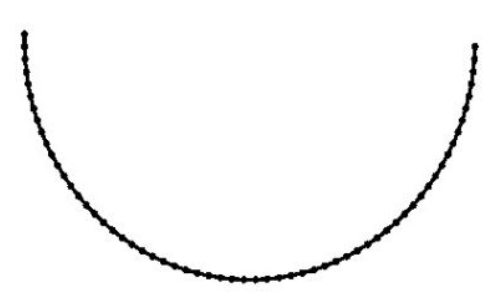

Neste tutorial, vais aprender a bordar um semicírculo (37,2 x 76,2 mm).

Deves já saber criar um objeto novo e inserir blocos nele. Se ainda precisares de ajuda, vê os tutoriais da série [Iniciação](../../game-tutorials/starter-tutorials/index.md). Além disso, os blocos de bordado já têm de estar ativados. Podes ver como fazer isto no tutorial **[Ativar os blocos de bordado](activate-embroidery-bricks.md)**.

Para mais informações ou sugestões de desenhos, vê os outros tutoriais.

*Aqui podes descarregar o tutorial em formato PDF*:

[Semicírculo](../../../media/embroidery-tutorials/Semicircle.pdf)

### 1. Cria um objeto de bordado novo (vê [Criar objetos de bordado](create-embroidery-objects.md)).

### 2. Agora começa e insere os blocos, passo a passo, no teu script.

### 3. Toca em play para começar o teu desenho!

Tens de definir o ângulo de rotação, aqui como 180 ÷ 60.

O 180 é sempre o mesmo num semicírculo! Por isso, tens de definir as repetições corretamente, como 60 aqui. **Experimenta outras combinações!** Por exemplo: 30 e 360 ÷ 30, ou 120 e 360 ÷ 120.

Experimenta também bordar um quarto de círculo (sugestão: 90 graus) ou outras variações.
