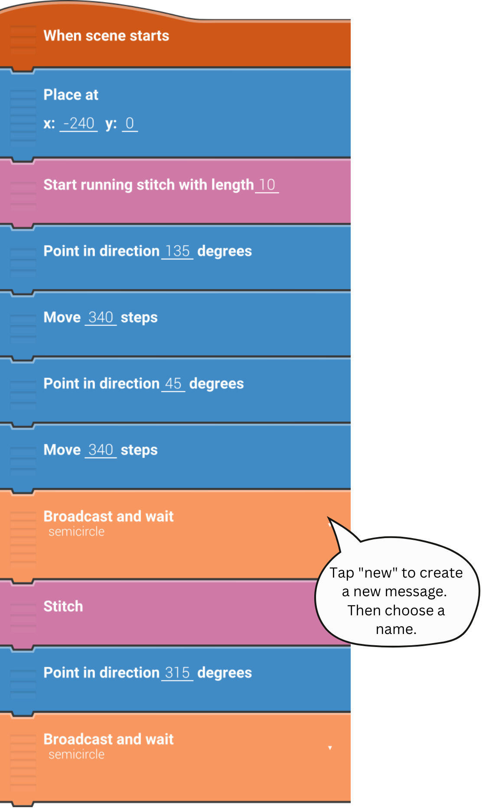

Neste tutorial, vais aprender a bordar um coração (103,6 x 112,8 mm).

Deves já saber o que é um ciclo e como funciona.

O tutorial **[Semicírculo](../embroidery-tutorials-beginner/semicircle.md)** pode ajudar-te neste tutorial.

Vê os tutoriais de bordado da série [Principiante](../embroidery-tutorials-beginner/index.md) se ainda não bordaste nada.

Para mais informações ou sugestões de desenhos, vê os outros tutoriais.

*Aqui podes descarregar o tutorial em formato PDF*:

[Coração](../../../media/embroidery-tutorials/Heart.pdf)

### 1. Cria um objeto de bordado novo (vê [Criar objetos de bordado](../embroidery-tutorials-beginner/create-embroidery-objects.md)) e insere os seguintes scripts:

### 2. Estrutura básica

### 3. Semicírculos

Esta parte é chamada sempre que a mensagem do semicírculo é enviada. Adiciona-a também ao teu script.

### 4. Toca em play para começar o teu desenho!
