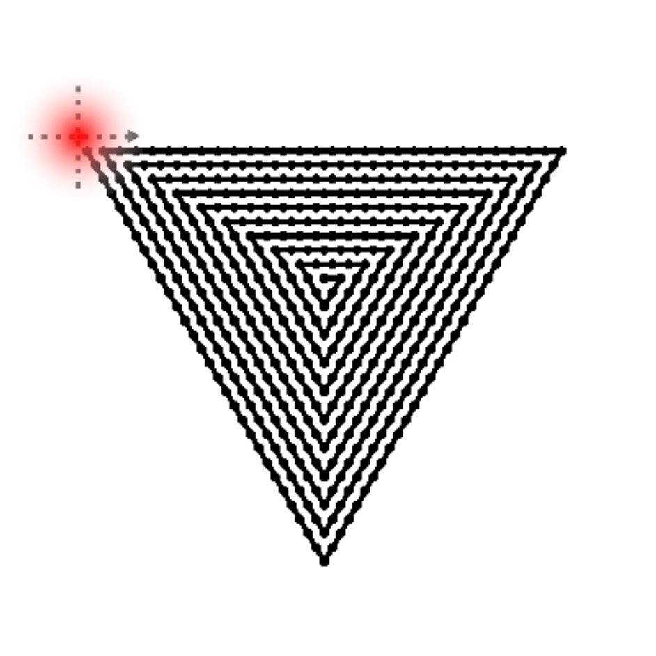

Neste tutorial, vais aprender a bordar uma espiral triangular (50,2 x 58 mm).

Deves já saber o que é um ciclo e como funciona.

Vê os tutoriais de bordado da série [Principiante](../embroidery-tutorials-beginner/index.md) se ainda não bordaste nada.

Para mais informações ou sugestões de desenhos, vê os outros tutoriais.

*Aqui podes descarregar o tutorial em formato PDF*:

[Espiral triangular](../../../media/embroidery-tutorials/Triangle-Spiral-1.pdf)

### 1. Cria um objeto de bordado novo (vê [Criar objetos de bordado](../embroidery-tutorials-beginner/create-embroidery-objects.md)) e insere o seguinte script:

### 2. Toca em play para começar o teu desenho!

Toca em “novo” para criar uma variável nova.

Vais encontrar a variável “degree” em dados.

