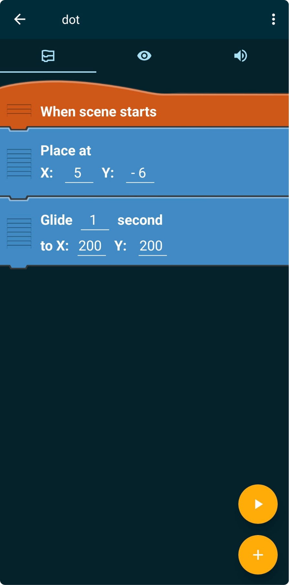

Neste tutorial, vais aprender onde encontrar vários blocos para programar um objeto. Além disso, este tutorial dá uma boa visão geral das categorias de blocos.

::project{id=6ac78173-445a-4280-8b8a-ea6b1e8e4af5}

Para inserir blocos e programar o teu objeto, deves já ter criado um projeto com um objeto. Se precisares de ajuda com isto, podes ver o tutorial **[Objeto novo](new-object.md)**.

*Aqui podes descarregar o tutorial em formato PDF:*

[Primeiros blocos](../../../media/game-tutorials/First-Bricks.pdf)

### 1. Abre um objeto existente

Primeiro, tens de abrir o teu projeto. Deves já ter criado um objeto (se não, vê o tutorial **[Objeto novo](new-object.md)**). Agora podes carregar no nome do objeto.

### 2. Blocos existentes

Depois vais ver que já existem alguns blocos. Esses blocos foram criados quando colocámos visualmente o objeto.

Estes blocos servem apenas para colocar o nosso objeto na posição exata que escolhemos no início, quando o projeto começa. Também podes mudar esta posição a qualquer momento aqui.

### 3. Inserir blocos

Agora podes criar mais blocos carregando no botão amarelo de mais, no canto inferior direito. Vai aparecer uma nova janela com várias categorias de blocos. Estas categorias são descritas no próximo passo.

### 4. Categorias de blocos

Estas são as diferentes categorias de blocos:

### 5. Inserir o primeiro bloco

Para os nossos primeiros blocos, queremos usar o bloco “Deslizar em 1 segundo para x: y:”. Podes encontrá-lo na categoria de movimento. Com o Editor de fórmulas podes editar o número de segundos e a posição X e Y.

### 6. Colocar o bloco

Coloca o bloco na última posição do teu programa e executa o programa pela primeira vez. Podes fazê-lo com o botão amarelo de play.

### 7. Conseguiste! Inseriste o teu primeiro bloco.

Agora programaste o teu primeiro objeto!

Se quiseres partilhar o teu projeto com os teus amigos, podes ver o tutorial **[Carregar e partilhar](upload-and-share.md)**, onde se explica exatamente como funciona. Senão, já podes começar o teu primeiro projeto próprio. Se precisares de ajuda ou de inspiração, vê os nossos tutoriais da série Principiante.

Podes encontrar mais informações sobre todos os blocos [aqui](../../../reference/)!
