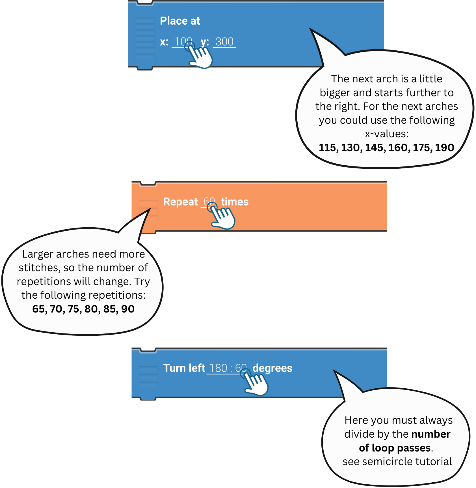

În acest tutorial vei învăța cum să brodezi un curcubeu (112 x 57,2 mm).

Ar trebui să știi deja ce este o buclă și cum funcționează.

Tutorialul **[Semicerc](../embroidery-tutorials-beginner/semicircle.md)** poate fi de ajutor pentru acest tutorial.

Uită-te la tutorialele de broderie din seria [pentru începători](../embroidery-tutorials-beginner/index.md) dacă nu ai brodat încă nimic.

Pentru mai multe informații sau sugestii de design, uită-te la celelalte tutoriale.

*Aici poți descărca tutorialul în format PDF*:

[Curcubeu](../../../media/embroidery-tutorials/Rainbow.pdf)

### 1. Creează un obiect nou de broderie (vezi [Creează obiecte de broderie](../embroidery-tutorials-beginner/create-embroidery-objects.md)):

### 2. Introdu următorul script:

### 3. Copiază obiectul

Pentru următorul arc, mai mare, poți pur și simplu să copiezi obiectul pe care tocmai l-ai creat.

Apasă pe cele trei puncte din colțul din dreapta sus al listei de obiecte.

Apoi mergi la „Copiază” și selectează obiectul.

Dacă folosești un obiect separat pentru fiecare arc, le poți broda mai târziu în culori diferite.

### 4. Adaptează obiectul

Ca arcurile să aibă acum dimensiuni diferite, trebuie să schimbăm câteva valori.

Pentru asta, mergi la scriptul obiectului copiat și modifică următoarele valori:

### 5. Repetă pașii 3 și 4 pentru mai multe arcuri!

### 6. Apasă pe play ca să pornești designul tău!
