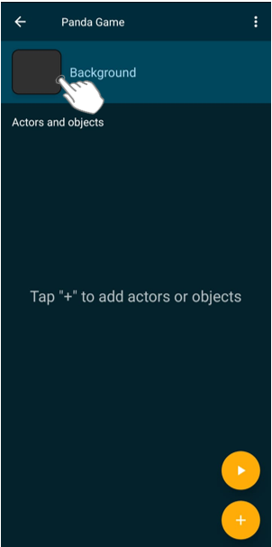

Poți adăuga un fundal în proiectul tău în Catrobat.

Fundalurile pot fi folosite în mai multe moduri. În Pocket Code, ele pot fi folosite pentru a îmbunătăți vizual **jocurile**, pentru a spune **povești** sau pentru a oferi personajelor și obiectelor tale mai mult context.

Pentru dispozitivele din makerspace, precum **plottere** sau **mașini de broderie**, fundalurile servesc drept șabloane de design, de exemplu pentru tăieturi sau modele de broderie.

\
Ca să adaugi un fundal, apasă pe „Fundal” în vizualizarea proiectului.\
[Deschide imaginea](../../../media/getting-started/grafik-16.png)

În **secțiunea de scripturi (2)**, poți programa fundalul tău – totuși, nu toate blocurile sunt disponibile. Următoarele două blocuri sunt deosebit de importante:  și 

În **secțiunea de costume (1)**, adaugi un fundal.

\
Pentru asta, apasă pe simbolul +.\
[Deschide imaginea](../../../media/getting-started/grafik-14.png)

Poți încărca propriile imagini, poți folosi fundaluri predefinite sau poți crea singur un fundal.

**Desenează**: Poți crea propriul tău fundal cu **Pocket Paint**. Pocket Paint este un program de desen ([mai multe despre Pocket Paint](https://catrobat.org/pocket-paint/))

**Costume**: Alege unul dintr-o colecție de fundaluri gata făcute ([mai multe despre biblioteca media](../elements/medialibrary.md)).

**Galerie**: Poți alege o imagine din galeria smartphone-ului tău.

**Cameră foto**: Poți folosi camera dispozitivului tău ca să faci o poză și s-o adaugi ca fundal.

\
Apasă pe săgeata înapoi din colțul din dreapta sus ca să te întorci la **Vizualizarea proiectului**.\
[Deschide imaginea](../../../media/getting-started/grafik-17.png)

Acum ai adăugat un fundal.
