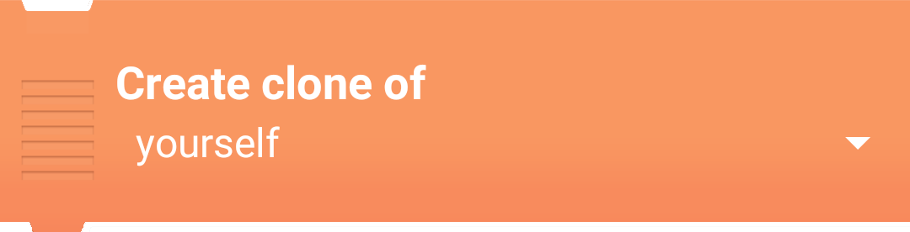

Acest bloc face o copie a obiectului indicat, numită clonă, care se comportă ca originalul. Imaginează-ți că dublezi un personaj sau un obiect din jocul tău. Clona poate avea propriile comportamente și scripturi, ceea ce îți permite să creezi mai multe instanțe ale unui obiect care pot acționa independent.
