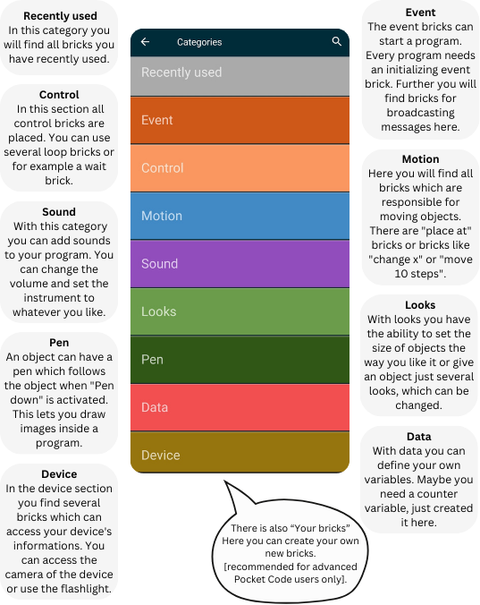

В этом уроке ты узнаешь, где найти разные блоки, чтобы запрограммировать объект. А ещё ты увидишь, какие бывают группы блоков.

Чтобы вставлять блоки и программировать объект, у тебя уже должен быть проект с объектом. Если тебе нужна помощь, посмотри урок **[Новый объект](new-object.md)**.

*Здесь можно скачать урок в формате PDF:*

[Первые блоки](../../../media/game-tutorials/First-Bricks.pdf)

### 1. Открой объект

Сначала открой свой проект. Объект у тебя уже должен быть (если нет, посмотри урок **[Новый объект](new-object.md)**). Теперь нажми на имя объекта.

### 2. Открой объект

Ты увидишь, что там уже есть несколько блоков. Они появились, когда мы ставили объект на экран.

Эти блоки делают только одно: при запуске проекта ставят объект точно туда, куда мы его поставили в начале. Здесь ты в любой момент можешь поменять это место.

### 3. Вставь блоки

Теперь добавь новые блоки: нажми на жёлтую кнопку с плюсом внизу справа. Откроется окно с группами блоков. О них рассказано в следующем шаге.

### 4. Группы блоков

Вот какие бывают группы блоков:

### 5. Вставь первый блок

Для первого раза возьмём блок «Скользить 1 секунду в точку x: y:». Он находится в группе «Движение». В редакторе формул можно поменять число секунд и место X и Y.

### 6. Поставь блок

Поставь блок в самый конец программы и запусти программу в первый раз. Для этого нажми на жёлтую кнопку запуска.

### 7. Получилось! Ты вставил свой первый блок.

Ты запрограммировал свой первый объект!

Ты запрограммировал свой первый объект!

Если хочешь показать проект друзьям, посмотри урок **[Выложить и поделиться](upload-and-share.md)**. Там всё подробно объяснено. А можешь уже сейчас начать свой первый проект. Если нужна помощь или идеи, посмотри наши уроки для начинающих.

Больше обо всех блоках можно узнать [здесь](../../../reference/)!
