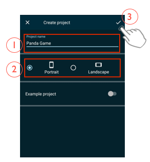

Открой приложение на телефоне или планшете. Нажми на значок +, чтобы создать новый проект.

Дай проекту имя (1) и выбери, какой будет игра: вертикальная или горизонтальная (2). Потом нажми на галочку (3).

Теперь ты в окне проекта. Вверху написано название твоей игры.

Ниже ты видишь **фон**. Сейчас фон пустой. Если хочешь его поменять, нажми на него.

Под фоном находятся твои **актеры и объекты**, которые ты добавил в игру. Сейчас здесь ещё пусто.

Внизу справа есть две важные кнопки:

 Кнопкой **Запуск** ты запускаешь игру.

 Кнопкой **Плюс** ты добавляешь в игру нового персонажа или объект.

