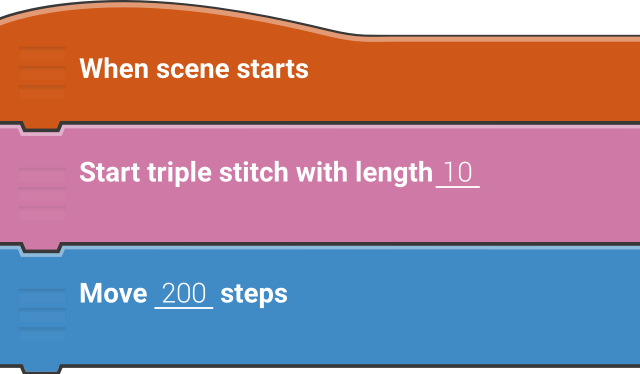

තුන් ගුණයක් තියෙන සයිට් එක හැම සයිට් එකක්ම තුන් පාරක් හයි කරනවා.

තුන් ගුණයක් තියෙන සීරීමෙන් පස්සේ ආපහු පනින්න වෙනවා, සීරීම් කරන්න වෙනවා, ඊට පස්සෙ ආයෙත් ඉස්සරහට පනින්න වෙනවා.

ඒකත් වැඩ කරන්නේ [ධාවන සීරීම](running-stitch.md) වගේ.

මේකෙන් සයිට් එක වැඩි වෙලා යනවා.

