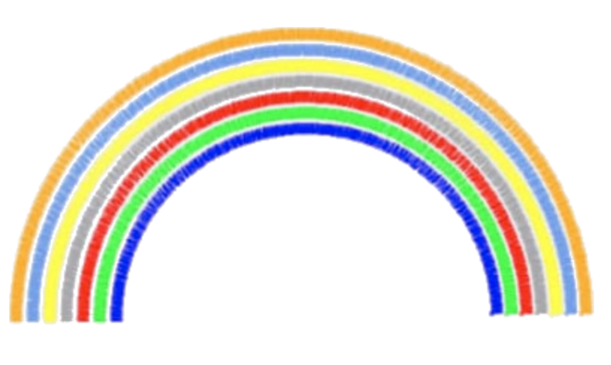

මෙම උපදෙස් මඟින්, ඔයා වැලිගුරු (112 x 57.2mm) සරඹ කරන ආකාරය ඉගෙන ගනු ඇත.

ඔයා දැනටමත් දන්නව ඇති ඒක මොකක්ද කියලා, කොහොමද වැඩ කරන්නේ කියලා.

**[අර්ධ චක් රය](../embroidery-tutorials-beginner/semicircle.md)** - මෙම උපදෙස් සඳහා උපකාරී විය හැකිය.

ඔයා තවමත් කිසිවක් සරසා නොමැති නම් [ආරම්භකයා](../embroidery-tutorials-beginner/index.md) මාලාවේ සරසවි නිබන්ධන දෙස බලන්න.

වැඩි විස්තර හෝ සැලසුම් යෝජනා සඳහා වෙනත් උපදෙස් බලන්න.

*මෙතනින් ඔයාට මෙම උපදෙස් PDF ආකෘතියෙන් බාගත හැකිය*:

[වැලිගුරු](../../../media/embroidery-tutorials/Rainbow.pdf)

### 1. නව මැහුම් වස්තුවක් නිර්මාණය කරන්න (බලන්න [විහිදුම් වස්තූන් නිර්මාණය කරන්න](../embroidery-tutorials-beginner/create-embroidery-objects.md)):

### 2. පහත සඳහන් script එක ඇතුල් කරන්න:

### 3. පිටපත් කිරීමේ වස්තුව

ඊළඟ විශාලතම ගෝලය සඳහා, ඔයාට නිකම්ම නිර්මාණය කළ වස්තුව පිටපත් කරන්න පුළුවන්.

වස්තුවේ දළ විශ්ලේෂණයේ ඉහළ දකුණු කෙළවරේ ඇති තිත් තුන මත ක්ලික් කරන්න.

ඊට පස්සේ “පිටපත් කරන්න” යන්න සහ වස්තුව තෝරන්න.

ඔයා එක් එක් ගෝනු සඳහා වෙනම වස්තුවක් භාවිතා කරන්නේ නම්, ඔයාට පසුව ඒවා විවිධ වර්ණවලින් සරසා ගත හැකිය.

### 4. විෂයයට අනුවර්තනය වීම

දැන් අරක් වෙනස් ප් රමාණයේ ඇති බව තහවුරු කර ගැනීම සඳහා, අපි අගයන් කිහිපයක් වෙනස් කළ යුතුයි.

මේක කරන්න, පිටපත් කරන ලද වස්තුවේ ස්ක් රිප්ට් එකට ගිහින් පහත සඳහන් අගයන් වෙනස් කරන්න:

### 5. තව චාපයක් ගන්න පියවර 3 සහ 4 නැවත කරන්න!

### 6. සෙල්ලම් කරන්න, ඔයාගේ නිර්මාණය පටන් ගන්න!
