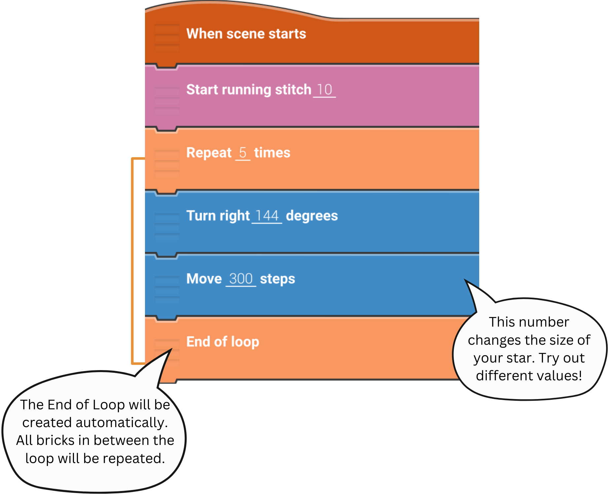

V tomto návode sa naučíš vyšívať hviezdu (57 x 60 mm).

Mal by si už vedieť, ako vytvoriť nový objekt a vložiť tam bloky. Ak ešte potrebuješ pomoc, pozri si návody v [sérii Starter](../../game-tutorials/starter-tutorials/index.md). Vyšívacie bloky musia byť navyše už zapnuté. Ako to urobiť, zistíš v návode **[Zapnutie vyšívacích blokov](activate-embroidery-bricks.md)**.

Viac informácií alebo nápadov na vzory nájdeš v ostatných návodoch.

*Tento návod si tu môžeš stiahnuť vo formáte PDF*:

[Hviezda](../../../media/embroidery-tutorials/Star.pdf)

### 1. Vytvor nový vyšívací objekt (pozri [Vytvorenie vyšívacích objektov](create-embroidery-objects.md)).

### 2. Teraz spusti a postupne vkladaj bloky do svojho skriptu.

### 3. Klikni na play a spusti svoj návrh!
