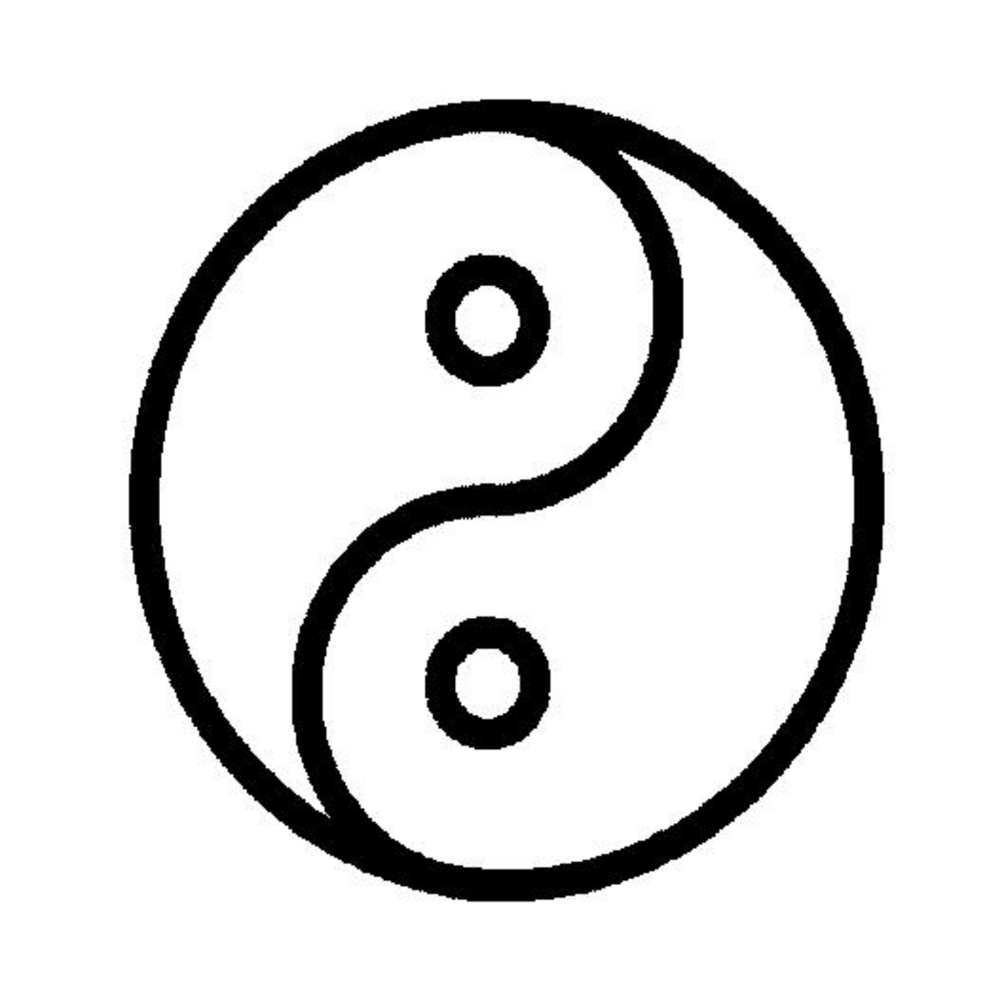

V tomto návode sa naučíš vyšívať jin a jang (78,4 x 78,4 mm).

Mal by si už vedieť, čo je slučka a ako funguje.

Pri tomto návode ti môže pomôcť návod **[Kruh](../embroidery-tutorials-beginner/circle.md)**.

Ak si ešte nič nevyšíval, pozri si vyšívacie návody zo série [pre začiatočníkov](../embroidery-tutorials-beginner/index.md).

Viac informácií alebo nápadov na vzory nájdeš v ostatných návodoch.

*Tento návod si tu môžeš stiahnuť vo formáte PDF*:

[Jin a jang](../../../media/embroidery-tutorials/Yin-and-Yang.pdf)

### 1. Vytvor nový vyšívací objekt (pozri [Vytvorenie vyšívacích objektov](../embroidery-tutorials-beginner/create-embroidery-objects.md)):

### 2. Pre veľký kruh vlož tento skript:

### 3. Stredová krivka

Pridaj aj túto časť do svojho skriptu:

### 4. Horný malý kruh

Vytvor nový vyšívací objekt a vlož tento skript:

### 5. Skopíruj malý kruh

Objekt z kroku 4 jednoducho skopíruj:

### 6. Dolný malý kruh

Musíš zmeniť polohu druhého kruhu:

### 7. Klikni na play a spusti svoj návrh!
