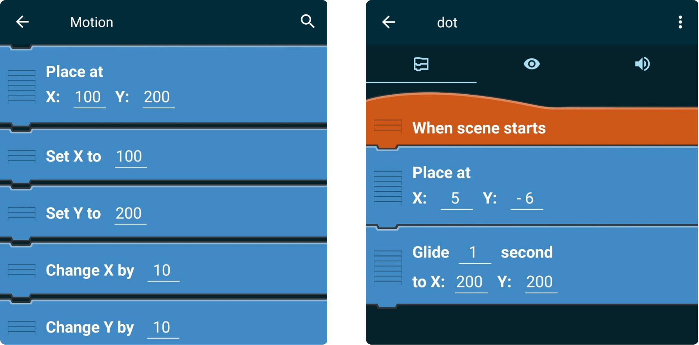

V tomto návode sa naučíš, kde nájsť rôzne bloky na naprogramovanie objektu. Návod zároveň dobre ukáže kategórie blokov.

Aby si mohol vkladať bloky a naprogramovať objekt, mal by si už mať vytvorený projekt s objektom. Ak potrebuješ pomoc, pozri si návod **[Nový objekt](new-object.md)**.

*Tento návod si tu môžeš stiahnuť vo formáte PDF:*

[Prvé bloky](../../../media/game-tutorials/First-Bricks.pdf)

### 1. Otvor existujúci objekt

Najprv musíš otvoriť svoj projekt. Mal by si už mať vytvorený objekt (ak nie, pozri si návod **[Nový objekt](new-object.md)**). Teraz môžeš kliknúť na názov objektu.

### 2. Existujúce bloky

Potom uvidíš, že tam už nejaké bloky sú. Tieto bloky vznikli, keď si objekt vizuálne umiestnil.

Tieto bloky len umiestnia náš objekt na presnú polohu, ktorú sme si na začiatku vybrali, hneď ako sa projekt spustí. Túto polohu tu môžeš kedykoľvek zmeniť.

### 3. Vloženie blokov

Ďalšie bloky vytvoríš kliknutím na žlté tlačidlo plus v pravom dolnom rohu. Otvorí sa nové okno s niekoľkými kategóriami blokov. Tieto kategórie sú opísané v ďalšom kroku.

### 4. Kategórie blokov

Toto sú rôzne kategórie blokov:

### 5. Vloženie prvého bloku

Pre naše prvé bloky chceme použiť blok „Kĺž 1 sekundu na x: y:“. Nájdeš ho v kategórii Pohyb. Pomocou editora vzorcov môžeš upraviť počet sekúnd a polohu X a Y.

### 6. Umiestni blok

Blok umiestni na poslednú pozíciu svojho programu a prvýkrát spusti svoj program. Urobíš to žltým tlačidlom play.

### 7. Zvládol si to! Vložil si svoj prvý blok.

Teraz si naprogramoval svoj prvý objekt!

Ak chceš zdieľať svoj projekt s kamarátmi, pozri si návod **[Nahratie a zdieľanie](upload-and-share.md)**, kde je presne vysvetlené, ako to funguje. Inak môžeš hneď začať so svojím prvým vlastným projektom. Ak potrebuješ pomoc alebo inšpiráciu, pozri sa na naše návody zo série pre začiatočníkov.

Viac informácií o všetkých blokoch nájdeš [tu](../../../reference/)!
