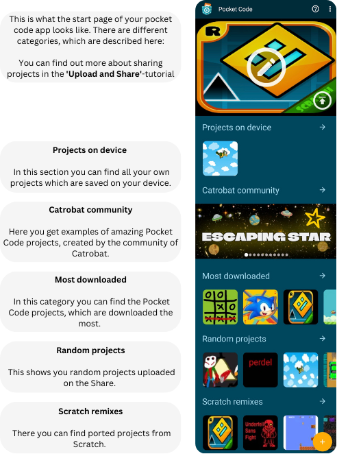

V tomto návode sa dozvieš všetko, čo potrebuješ vedieť o aplikácii Pocket Code, aby si mohol začať vytvárať svoj prvý projekt. Krok za krokom ti ukážeme, ako aplikáciu stiahnuť, otvoriť a vytvoriť nový projekt.

Toto je úplne prvý návod a nepotrebuješ na to žiadne predchádzajúce znalosti.

Na čo ešte čakáš? Zober si telefón a začni hneď teraz!

*Tento návod si tu môžeš stiahnuť vo formáte PDF:*

[Nový program](../../../media/game-tutorials/New-Program.pdf)

### 1. Inštalácia aplikácie Pocket Code

Najprv musíš aplikáciu Pocket Code nainštalovať do svojho zariadenia. Nájdeš ju tak, že v Obchode Google Play vyhľadáš „Pocket Code“ a klikneš na „Inštalovať“. Na tento krok potrebuješ účet Google. Zariadenie potom aplikáciu stiahne a nainštaluje. Tento krok môže trvať dlhšie, podľa rýchlosti tvojho internetu.

Po úspešnom stiahnutí a inštalácii aplikácie Pocket Code ju nájdeš v zozname aplikácií alebo na domovskej obrazovke, podľa toho, aký máš telefón. Aplikáciu môžeš ľubovoľne presunúť na ľubovoľné miesto.

### 2. Spusti aplikáciu

Keď aplikáciu otvoríš, uvidíš rôzne kategórie:

### 3. Vytvor nový projekt

Ďalší krok je vytvoriť nový projekt. Urobíš to stlačením žltého tlačidla plus v pravom dolnom rohu. Teraz musíš zadať názov projektu a vybrať, či má byť projekt na šírku, alebo nie. Stlačením „OK“ sa projekt vytvorí.

### 4. Zvládol si to! Vytvoril si svoj vlastný nový projekt.

Teraz máš nainštalovaný Pocket Code a vieš, ako vytvoriť nový projekt. Môžeš začať programovať!

Na to potrebuješ vedieť, ako vytvoriť nový objekt v projekte. Pozri si návod **[Nový objekt](new-object.md)**, kde ti všetko krok za krokom vysvetlíme.
