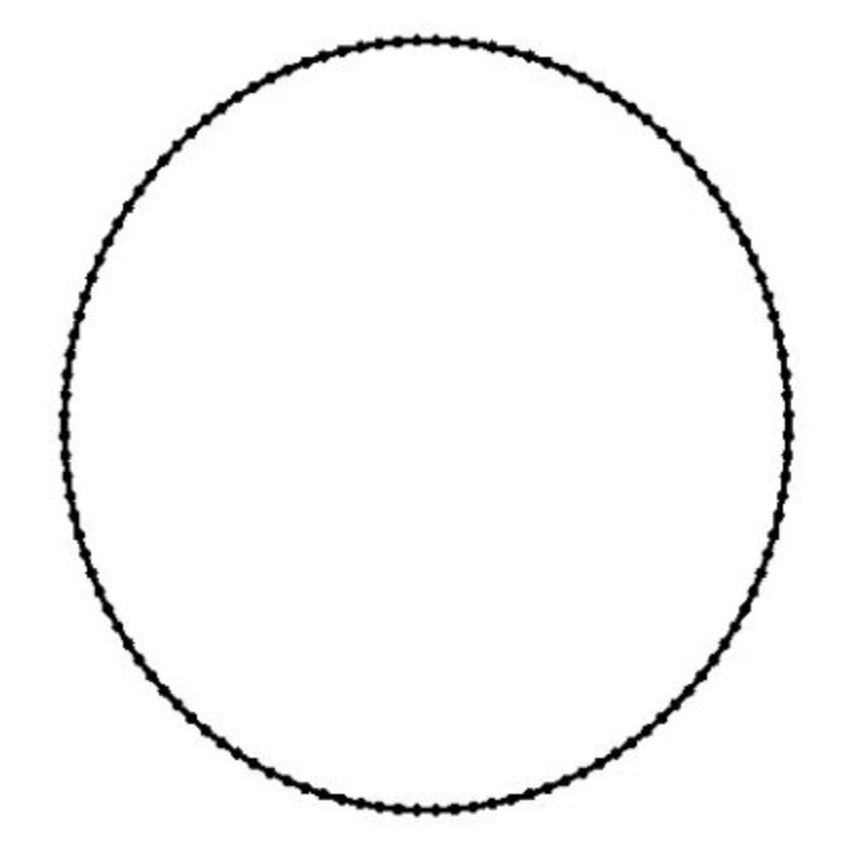

V tej vadnici se boš naučil vesti krog (76,2 x 76,2 mm).

Že moraš znati ustvariti nov predmet in vanj vstaviti bloke. Če še potrebuješ pomoč, si oglej vadnice v [seriji za začetnike](../../game-tutorials/starter-tutorials/index.md). Poleg tega morajo biti bloki za vezenje že vklopljeni. Kako to narediš, izveš v vadnici **[Vklop blokov za vezenje](activate-embroidery-bricks.md)**.

Za več informacij ali predloge za zasnove si oglej druge vadnice.

*Tukaj lahko preneseš vadnico v obliki PDF*:

[Krog](../../../media/embroidery-tutorials/Circle.pdf)

### 1. Ustvari nov predmet za vezenje (glej [Ustvari predmete za vezenje](create-embroidery-objects.md)).

### 2. Zdaj začni in korak za korakom vstavi bloke v svojo skripto.

### 3. Tapni predvajanje, da začneš svojo zasnovo!

Določiti moraš kot vrtenja, tukaj 360 ÷ 60.

360 pri krogu vedno ostane enako! Zato moraš ponovitve nastaviti ustrezno, na primer 60 tukaj. **Preizkusi druge kombinacije!** Na primer: 30 in 360 ÷ 30 ali 120 in 360 ÷ 120.
