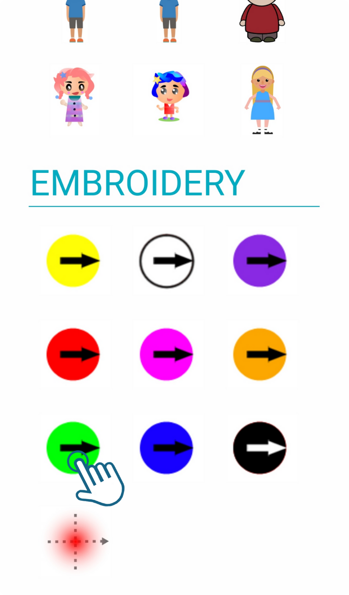

V tej vadnici se boš naučil ustvarjati predmete, s katerimi lahko pozneje vesel svoje vzorce.

Za to vadnico moraš že znati ustvariti projekt. Če potrebuješ pomoč, si oglej vadnice iz [serije za začetnike](../../game-tutorials/starter-tutorials/index.md).

Za več informacij ali predloge za zasnove si oglej druge vadnice.

*Tukaj lahko preneseš vadnico v obliki PDF*:

[Ustvari predmete za vezenje](../../../media/embroidery-tutorials/Create-Embroidery-Objects.pdf)

### 1. Tapni gumb plus na spodnjem desnem delu projekta, da dodaš nov predmet.

### 2. Če želiš izbrati sliko, pojdi v medijsko knjižnico.

### 3. Predmet za vezenje predstavlja eno raven igle vezilnega stroja. Več predmetov za vezenje se veze enega za drugim. Tako lahko uporabiš več barv.

Predmet izbereš glede na barvo, ki jo želiš.

Pomakni se navzdol in poišči ustrezno puščico.

### 4. Novemu predmetu daj ustrezno ime in pritisni V redu.

### 5. Zdaj si ustvaril nov predmet. Dodaš lahko skripto in ga programiraš.

Zdaj veš, kako ustvariti predmet. Za vsako barvo, ki jo želiš uporabiti, dodaj nov predmet.

Vsaki barvi lahko dodaš skripto in programiraš svoje lastne zasnove ter jih pozneje tudi vesel.

Potrebuješ navdih ali pomoč? Oglej si naše druge vadnice!
