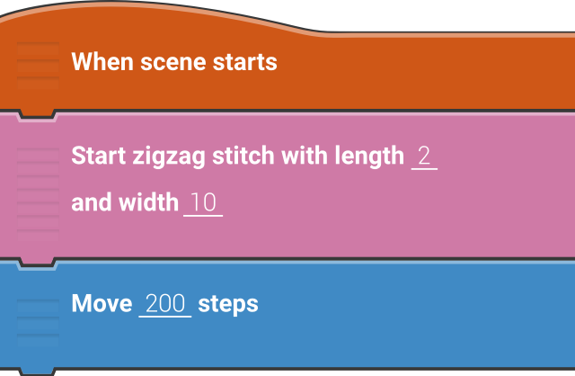

Shkodër vazhdimisht me një gjatësi dhe gjerësi të ndryshëm.

Shkodër në një model 'zigzag'.

Provoni vlera të ndryshme për gjatësinë dhe gjerësinë për të mësuar këtë bllok kodi.

Mund të shtrihësh shije më të trashë me shtrihen e zigzag.

