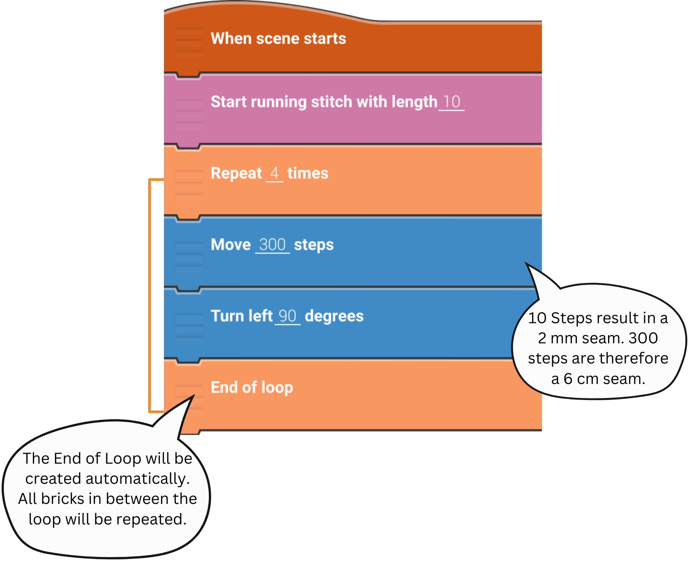

Në këtë mësimdhënie, do të mësoni se si të bordoni një katror (60 x 60 mm).

Ju duhet të dini tashmë si për të krijuar një objekt të ri dhe të futni blloqe kod atje. Ndihmë në tutorialin e numrit [Seritë fillestare](../../game-tutorials/starter-tutorials/index.md) nëse keni nevojë për ndihmë. Përveç kësaj, blloqet e kodit të bordurave duhet të jenë tashmë aktive. Mund ta gjeni se si ta bëni këtë në tutorialin **[Aktivoni blloqet e kodit të bordurave](activate-embroidery-bricks.md)**.

Për më shumë informacion ose sugjerime për dizajn, shikoni tutorialët e tjerë.

*Këtu ju mund të shkarkoni tutorialin në formatin PDF*:

[Katror](../../../media/embroidery-tutorials/Square.pdf)

### 1. Krijoni një objekt të ri borduri (shih [Krijoni objekte bordure](create-embroidery-objects.md)).

### 2. Tani filloni dhe futni blloket e kodit hap pas hapi në skenar.

Një katror është ndërtuar nga katër linja, që takohen në një kënd 90°.

Në fillim, skenarja e drejton shkopin. Pas kësaj, ajo lëvizin gjurmë 300 hapa dhe kthehet 90°. Kjo do të përsëritet 4 herë.

Çfarë do të ndodhë nëse rregulloni këndin ose shkallët? **Provoni!**

### 3. Klikoni në lojë për të filluar projektimin tuaj!
