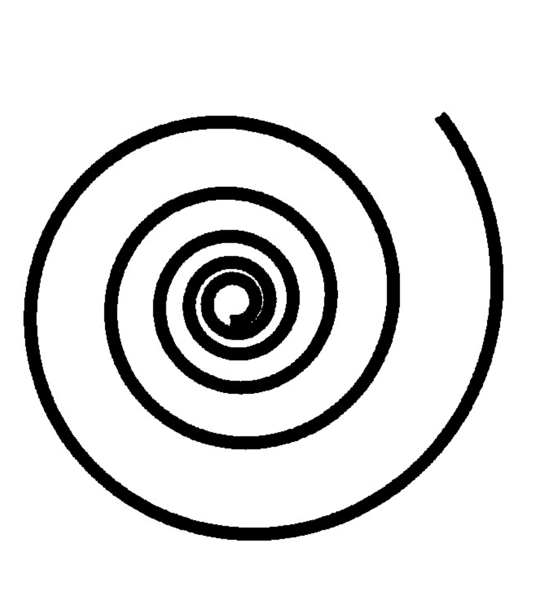

Në këtë mësimdhënie, do të mësoni se si të bordoni një spiralë (103.9 x 116.6 mm).

Duhet ta dini se çfarë është një rruge dhe si funksionon.

Tutorial **[Qerq](../embroidery-tutorials-beginner/circle.md)**- mund të jetë i dobishëm për këtë tutorial.

Shikoni tutorialët e bordurave në serinë [Fillimor](../embroidery-tutorials-beginner/index.md) nëse nuk keni bordur asgjë ende.

Për më shumë informacion ose sugjerime për dizajn, shikoni tutorialët e tjerë.

*Këtu ju mund të shkarkoni tutorialin në formatin PDF*:

[Spiral](../../../media/embroidery-tutorials/Spiral.pdf)

### 1. Krijoni një objekt të ri borduri (shih [Krijoni objekte bordure](../embroidery-tutorials-beginner/create-embroidery-objects.md)) dhe futni skenarën e mëposhtme:

### 2. Klikoni në lojë për të filluar projektimin tuaj!

Vështroni «i ri…» për të krijuar një variabil të ri.

Do të gjeni variablen «degree» në të dhëna.

