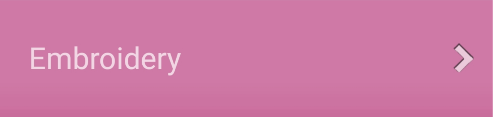

У овом туторијалу се објашњава како се укључују блокови за вез.

За ово не треба никакво знање програмирања. Ово је први корак са туторијалима за вез. Касније ћеш моћи да дизајнираш, програмираш и чак извезеш своје дизајне на свој омиљени комад тканине.

За више информација или предлоге за дизајне погледај остале туторијале.

*Туторијал можеш да преузмеш у PDF формату:*

[ActivateEmbroideryBricks](../../../media/embroidery-tutorials/ActivateEmbroideryBricks.pdf)

### 1. Покрени апликацију „Pocket Code“. Прати кликове!

### 2. Отвори мени (три тачке у горњем десном углу).

### 3. Иди на „Подешавања“.

### 4. Изабери „Проширење за вез“.

### 5. Блокове за вез ћеш наћи као посебну категорију међу својим блоковима!

Сада ћеш све блокове за вез наћи и међу осталим блоковима.

За више информација о сваком блоку погледај документацију блокова [овде](../../../reference/) или прати туторијал **[Блокови за вез](embroidery-bricks/index.md)**.

Сада можеш да почнеш и направиш своје дизајне!

Ако ти требају идеје или помоћ за то, погледај остале туторијале или настави са туторијалом **[Направи објекте за вез](create-embroidery-objects.md)**.
