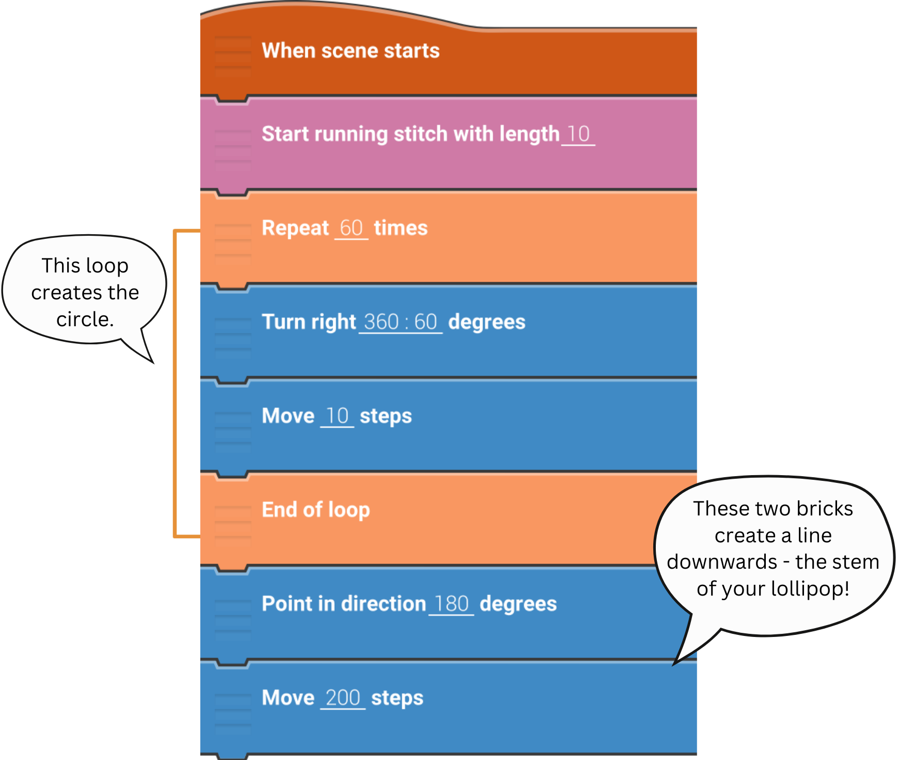

У овом туторијалу ћеш научити како да извезеш лизалицу (54,7 x 54,8 mm).

Већ треба да знаш како да направиш нови објекат и убациш блокове у њега. Слободно погледај туторијале у [серији за почетнике](../../game-tutorials/starter-tutorials/index.md) ако ти још треба помоћ. Осим тога, блокови за вез већ морају бити укључени. Како се то ради, можеш да сазнаш у туторијалу **[Укључи блокове за вез](activate-embroidery-bricks.md)**.

За више информација или предлоге за дизајне погледај остале туторијале.

*Туторијал можеш да преузмеш у PDF формату:*

[Лизалица](../../../media/embroidery-tutorials/Lollipop.pdf)

### 1. Направи нови објекат за вез (погледај [Направи објекте за вез](create-embroidery-objects.md)).

### 2. Сада покрени и убацуј блокове корак по корак у своју скрипту.

### 3. Додирни пусти да почнеш свој дизајн!

Погледај туторијал **[Круг](circle.md)** за више информација о томе како се вези круг.
