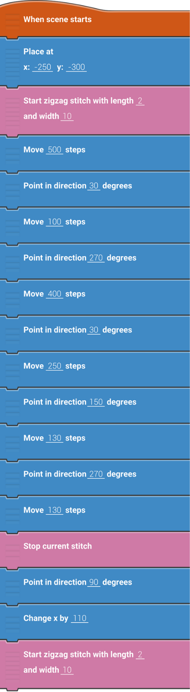

У овом туторијалу ћеш научити како да извезеш Пенроузов троугао (105,6 x 120,6 mm).

Погледај туторијале за вез у серији за [почетнике](../embroidery-tutorials-beginner/index.md) ако још ниси ништа извезао.

За више информација или предлоге за дизајне погледај остале туторијале.

*Туторијал можеш да преузмеш у PDF формату:*

[Пенроузов троугао](../../../media/embroidery-tutorials/Penrose-Triangle.pdf)

### 1. Направи нови објекат за вез (погледај [Направи објекте за вез](../embroidery-tutorials-beginner/create-embroidery-objects.md)) и убаци следећу скрипту:

### 2. Први део:

### 3. Други део

### 4. Додирни пусти да почнеш свој дизајн!
