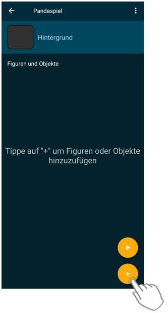

\
Додирни дугме плус да додаш нови лик или објекат у свој пројекат.\
[Отвори слику](../../../media/getting-started/FigurHinzufuegen.png)

У Pocket Code-у можеш да додаш лик или објекат у свој пројекат на више начина:

**Нацртај**: Можеш сам да направиш свог лика помоћу **Pocket Paint**-а. Pocket Paint је програм за цртање ([више о Pocket Paint-у](https://catrobat.org/pocket-paint/))

**Изгледи**: Изабери једног из збирке унапред направљених ликова и објеката ([више о медијатеци](../elements/medialibrary.md)).

**Галерија**: Можеш да изабереш слику из галерије на свом телефону.

**Библиотека**: У библиотеци ћеш наћи ликове и објекте који су већ програмирани, што значи да већ имају скрипту. Можеш да их изабереш ако хоћеш да користиш готове елементе у својој игрици (нпр. одбројавање) ([више о библиотеци](../elements/medialibrary.md#додај-објекат-из-медијатеке)).

**Камера**: Можеш да користиш камеру свог уређаја да направиш фотографију и додаш је као лик.

**Ранац**: Ранац је тренутно празан. Можеш поново да користиш ликове или објекте које си сачувао у свом ранцу. Цела скрипта се распакује заједно са њима ([више о ранцу](../elements/backpack.md)).

**Локални ликови и објекти**: Овде ћеш наћи направљене ликове које можеш да користиш у свом пројекту. Локални ликови и објекти раде као медијатека ван мреже, што значи да можеш да им приступиш и кад немаш интернет везу.

**Празан објекат**: Додај празан објекат, а то је објекат који нема изглед. Можеш га програмирати као и сваки други.

**Локални пројекти**: Изабери пројекат из којег хоћеш да убациш први лик заједно са скриптом у свој пројекат.

\
У Pocket Code-у можеш да додаш лик или објекат у свој пројекат на више начина.\
[Отвори слику](../../../media/getting-started/NewActor-e1732794461668.jpg)
