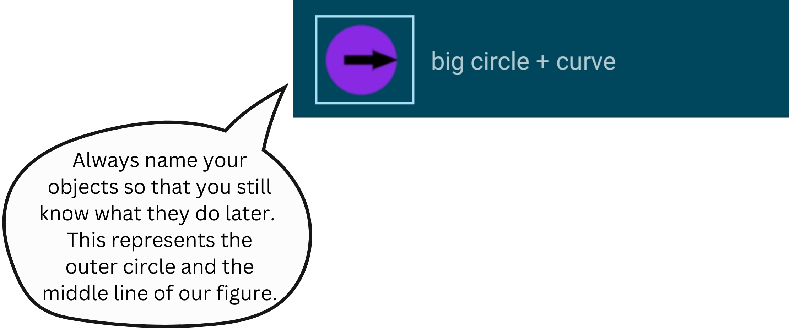

I den här tutorialen lär du dig att brodera Yin och Yang (78,4 x 78,4 mm).

Du bör redan veta vad en loop är och hur den fungerar.

Tutorialen **[Cirkel](../embroidery-tutorials-beginner/circle.md)** kan vara till hjälp för den här tutorialen.

Titta på broderitutorialerna i [nybörjarserien](../embroidery-tutorials-beginner/index.md) om du inte har broderat något än.

För mer information eller designförslag kan du titta på de andra tutorialerna.

*Här kan du ladda ner tutorialen i PDF-format*:

[Yin och Yang](../../../media/embroidery-tutorials/Yin-and-Yang.pdf)

### 1. Skapa ett nytt broderiobjekt (se [Skapa broderiobjekt](../embroidery-tutorials-beginner/create-embroidery-objects.md)):

### 2. Lägg in följande skript för den stora cirkeln:

### 3. Mittkurvan

Lägg till den här delen i ditt skript också:

### 4. Övre lilla cirkeln

Skapa ett nytt broderiobjekt och lägg in följande skript:

### 5. Kopiera den lilla cirkeln

Du kan helt enkelt kopiera objektet från steg 4:

### 6. Nedre lilla cirkeln

Du måste ändra positionen för den andra cirkeln:

### 7. Tryck på play för att starta din design!
