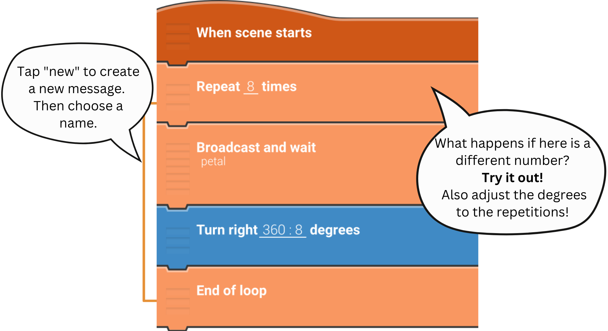

இந்த பயிற்சியில், நீ ஒரு லோட்டஸ் (64.8 x 64.8mm) எம்பிராய்டரிங் எப்படி கற்றுக்கொள்வீர்கள்.

ஒரு சுழற்சி என்றால் என்ன, அது எவ்வாறு இயங்குகிறது என்பதை நீ ஏற்கனவே அறிந்து கொள்ள வேண்டும்.

நீ இன்னும் எம்பிராய்டரி செய்யவில்லை என்றால் [ஆரம்பநிலை](../embroidery-tutorials-beginner/index.md) தொடரில் உள்ள எம்பிராய்டரி பயிற்சிகளைப் பார்.

மேலும் தகவலுக்கு அல்லது வடிவமைப்பு ஆலோசனைகளுக்கு மற்ற பயிற்சிகளைப் பார்க்கவும்.

*இங்கே நீ பயிற்சி பதிவிறக்க முடியும் PDF-பார்மாட்டில்*:

[லோட்டஸ்](../../../media/embroidery-tutorials/Lotus.pdf)

### 1. ஒரு புதிய எம்பிராய்டரி பொருளை உருவாக்கவும் (பார்க்க [எம்பிராய்டரி பொருட்களை உருவாக்கவும்](../embroidery-tutorials-beginner/create-embroidery-objects.md)) பின்வரும் ஸ்கிரிப்ட்களை செருகவும்ஃ:

### 2. அடிப்படை அமைப்பு

### 3. கனிமக்கல்லிகள்

இந்த பகுதி ஒவ்வொரு முறையும் பெட்டல் செய்தி அனுப்பப்படும் போது அழைக்கப்படுகிறது. அதை உன் திரைக்கதைக்கு சேர்க்கவும்.

### 4. உன் வடிவமைப்பு தொடங்க விளையாட தட்டு!
