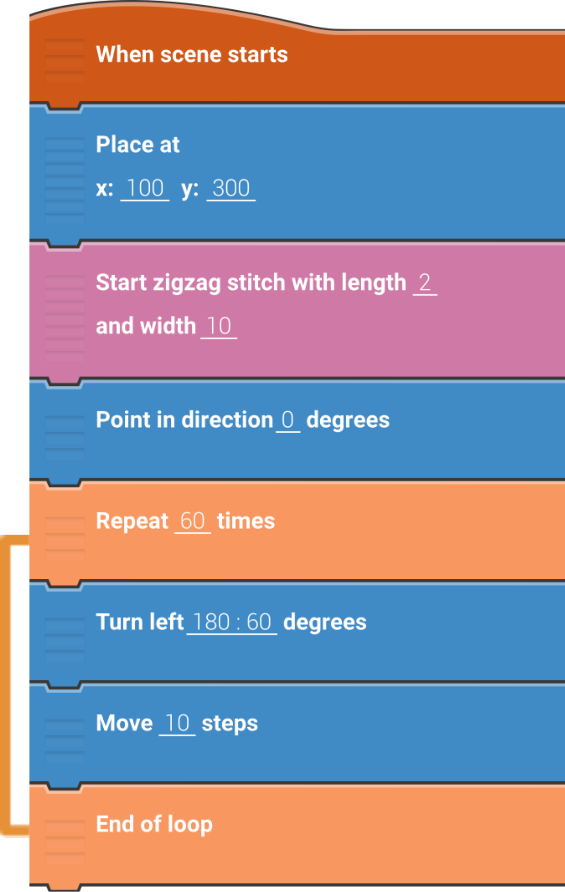

இந்த பயிற்சியில், நீ ஒரு வானவில்லையை (112 x 57.2mm) எம்பிராய்டரி செய்வது எப்படி என்பதைக் கற்றுக்கொள்வீர்கள்.

ஒரு சுழற்சி என்றால் என்ன, அது எவ்வாறு இயங்குகிறது என்பதை நீ ஏற்கனவே அறிந்து கொள்ள வேண்டும்.

**[அரைவட்டம்](../embroidery-tutorials-beginner/semicircle.md)** - பயிற்சி இந்த பயிற்சிக்காக உதவியாக இருக்கலாம்.

நீ இன்னும் எம்பிராய்டரி செய்யவில்லை என்றால் [ஆரம்பநிலை](../embroidery-tutorials-beginner/index.md) தொடரில் உள்ள எம்பிராய்டரி பயிற்சிகளைப் பார்.

மேலும் தகவலுக்கு அல்லது வடிவமைப்பு ஆலோசனைகளுக்கு மற்ற பயிற்சிகளைப் பார்க்கவும்.

*இங்கே நீ பயிற்சி பதிவிறக்க முடியும் PDF-பார்மாட்டில்*:

[வானவில்](../../../media/embroidery-tutorials/Rainbow.pdf)

### 1. ஒரு புதிய எம்பிராய்டரி பொருளை உருவாக்கவும் (பார்க்க [எம்பிராய்டரி பொருட்களை உருவாக்கவும்](../embroidery-tutorials-beginner/create-embroidery-objects.md)):

### 2. பின்வரும் எழுத்துருவைச் சேர்க்கவும்ஃ:

### 3. பொருள் நகல்

அடுத்த பெரிய வளைவுக்காக, நீ உருவாக்கிய உருப்படியை நகலெடுக்கலாம்.

பொருளின் கண்ணோட்டத்தின் மேல் வலது மூலையில் உள்ள மூன்று புள்ளிகளை கிளிக் செய்யவும்.

பின்னர் “நகலெடு” க்கு சென்று பொருள் தேர்ந்தெடுக்கவும்.

ஒவ்வொரு வளைவுக்கும் தனி பொருள் பயன்படுத்தினால், பின்னர் அவற்றை வெவ்வேறு நிறங்களில் எம்பிராய்டரி செய்யலாம்.

### 4. பொருளை மாற்றியமைத்தல்

வளைகள் இப்போது வேறு அளவுகளில் இருப்பதை உறுதி செய்ய, சில மதிப்புகளை மாற்ற வேண்டும்.

இதைச் செய்ய, நகலெடுக்கப்பட்ட பொருளின் ஸ்கிரிப்டிற்கு சென்று பின்வரும் மதிப்புகளை சரிசெய்யவும்ஃ:

### 5. மேலும் வளைவுகளை பெற 3 மற்றும் 4 படிகளை மீண்டும் செய்யவும்!

### 6. உன் வடிவமைப்பு தொடங்க விளையாட தட்டு!
