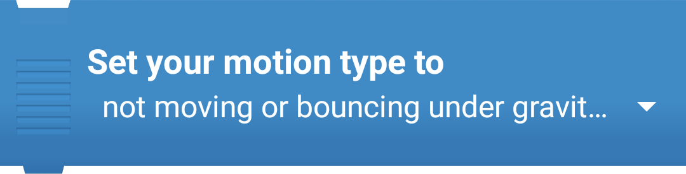

ஒரு பொருளின் இயக்கம் மாற்றப்படுகிறது, அதாவது ஈர்ப்பின் கீழ் அது நகரும் மற்றும் குதிக்கும்படி அனுமதிக்கிறது, ஈர்ப்பின் கீழ் அது நகராது ஆனால் மற்றவர்கள் உன்னை விட்டு குதிக்கிறார்கள் அல்லது ஈர்ப்பின் கீழ் நகராத அல்லது வரையறுக்கப்படுவதில்லை. அது உன் கதாபாத்திரம் எப்படி நடந்துகொள்வது என்பதை தேர்ந்தெடுப்பது போன்றது.
