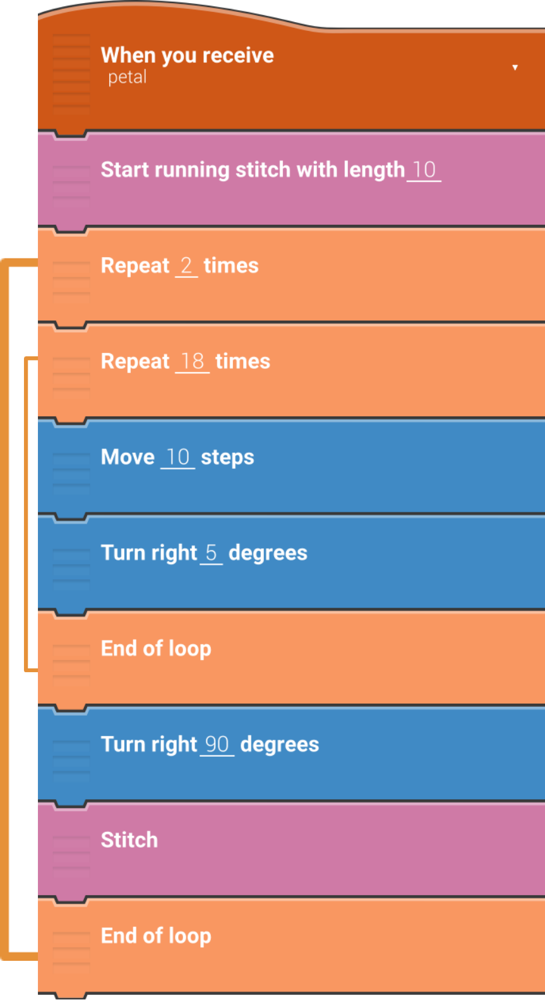

ในบทเรียนนี้ คุณจะได้เรียนรู้วิธีปักบัวหลวง (64.8 x 64.8 มม.)

คุณควรรู้ก่อนว่าการวนซ้ำคืออะไรและทำงานอย่างไร

ลองดูบทเรียนงานปักใน ชุด [ระดับมือใหม่](../embroidery-tutorials-beginner/index.md) ถ้าคุณยังไม่เคยปักอะไรมาก่อน

หากต้องการข้อมูลเพิ่มเติมหรือไอเดียการออกแบบ ลองดูบทเรียนอื่น ๆ

*ที่นี่คุณดาวน์โหลดบทเรียนในรูปแบบ PDF ได้*:

[บัวหลวง](../../../media/embroidery-tutorials/Lotus.pdf)

### 1. สร้างตัวละครงานปักใหม่ (ดู [สร้างตัวละครงานปัก](../embroidery-tutorials-beginner/create-embroidery-objects.md)) แล้วใส่สคริปต์ต่อไปนี้:

### 2. โครงสร้างพื้นฐาน

### 3. กลีบดอก

ส่วนนี้จะถูกเรียกทุกครั้งที่ส่งข้อความ "กลีบดอก" ให้เพิ่มเข้าไปในสคริปต์ของคุณด้วย

### 4. กดเล่นเพื่อเริ่มออกแบบของคุณ!
