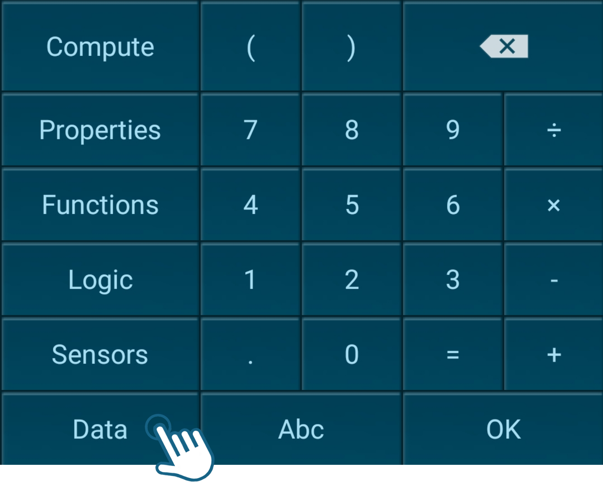

ในบทเรียนนี้ คุณจะได้เรียนรู้วิธีปักเกลียวสามเหลี่ยม (50.2 x 58 มม.)

คุณควรรู้ก่อนว่าการวนซ้ำคืออะไรและทำงานอย่างไร

ลองดูบทเรียนงานปักใน ชุด [ระดับมือใหม่](../embroidery-tutorials-beginner/index.md) ถ้าคุณยังไม่เคยปักอะไรมาก่อน

หากต้องการข้อมูลเพิ่มเติมหรือไอเดียการออกแบบ ลองดูบทเรียนอื่น ๆ

*ที่นี่คุณดาวน์โหลดบทเรียนในรูปแบบ PDF ได้*:

[เกลียวสามเหลี่ยม](../../../media/embroidery-tutorials/Triangle-Spiral-1.pdf)

### 1. สร้างตัวละครงานปักใหม่ (ดู [สร้างตัวละครงานปัก](../embroidery-tutorials-beginner/create-embroidery-objects.md)) แล้วใส่สคริปต์ต่อไปนี้:

### 2. กดเล่นเพื่อเริ่มออกแบบของคุณ!

กด "ใหม่" เพื่อสร้างตัวแปรใหม่

คุณจะพบตัวแปร "degree" ในหมวด ข้อมูล

