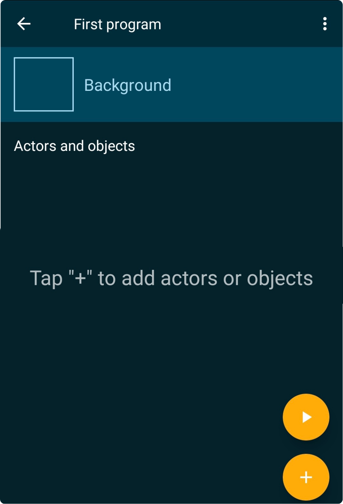

ในบทเรียนนี้ คุณจะได้เรียนรู้วิธีสร้างตัวละครใหม่ในโปรเจกต์ของคุณ และวิธีต่าง ๆ ที่ทำได้

\
ในบทเรียนนี้ คุณจะได้เรียนรู้วิธีสร้างตัวละครใหม่ในโปรเจกต์ของคุณ และวิธีต่าง ๆ ที่ทำได้\
[เปิดรูปภาพ](../../../media/game-tutorials/New-Object.png)

ในการทำเช่นนี้ คุณควรดาวน์โหลดแอป Pocket Code และรู้วิธีสร้างโปรเจกต์ใหม่มาก่อน ถ้าต้องการความช่วยเหลือ ดูบทเรียน **[โปรเจกต์ใหม่](new-project.md)** ได้เลย

*ที่นี่คุณดาวน์โหลดบทเรียนในรูปแบบ PDF ได้:*

[เปิด PDF](../../../media/game-tutorials/New-Object.pdf)

### 1. สร้างตัวละครใหม่

ขั้นแรก คุณต้องเปิดโปรเจกต์ใหม่ของคุณ

คุณจะพบโปรเจกต์บนหน้าจอหลักของแอป Pocket Code ถ้าคุณมีโปรเจกต์มากกว่าหนึ่งโปรเจกต์ ให้กด "โปรเจกต์ในอุปกรณ์" แล้วเลือกโปรเจกต์ใหม่ของคุณ ถ้ายังไม่ได้สร้างโปรเจกต์ใหม่ หรืออยากรู้เพิ่มเติมว่าทำอย่างไร ดูบทเรียน **[โปรเจกต์ใหม่](new-project.md)** ได้

### 2. สร้างตัวละครใหม่

\
ตอนนี้คุณพร้อมสร้างตัวละครใหม่แล้ว ให้กดปุ่มบวกสีเหลืองที่มุมขวาล่าง คุณจะเห็นหน้าต่างใหม่ที่มีวิธีให้เลือกเจ็ดแบบ\
[เปิดรูปภาพ](../../../media/game-tutorials/New-Object-1.png)

### 3. วิธีสร้าง

\
นี่คือวิธีที่คุณเลือกได้.\
[เปิดรูปภาพ](../../../media/game-tutorials/New-Object-2.png)

### 4. วาดรูป

เพื่อให้ง่ายที่สุดสำหรับมือใหม่ เราจะใช้ฟังก์ชัน "วาดรูป" แล้ววาดจุดเล็ก ๆ เมื่อคุณวาดจุดด้วย Pocket Paint เสร็จแล้ว คุณออกได้ (โดยย้อนกลับไปหนึ่งขั้น)

### 5. ตั้งชื่อ

ตอนนี้คุณต้องตั้งชื่อให้รูปของคุณ

### 6. วางตำแหน่ง

\
หลังจากนั้น คุณต้องวางรูปด้วยการลากไปทางซ้ายหรือขวา หรือขึ้นหรือลง ด้วยนิ้วของคุณ แล้วบันทึกด้วยปุ่มที่มุมขวาบน\
[เปิดรูปภาพ](../../../media/game-tutorials/New-Object-3.png)

### 7. ทำสำเร็จแล้ว! คุณสร้างตัวละครใหม่ของตัวเองแล้ว

ตอนนี้คุณมีโปรเจกต์ที่มีตัวละครหนึ่งตัวที่คุณเขียนโปรแกรมได้แล้ว!

ก่อนจะเขียนโปรแกรม คุณควรรู้ว่ามีบล็อกอะไรบ้าง บทเรียน **[บล็อกแรก](first-bricks.md)** จะให้ภาพรวมที่ดีของหมวดหมู่บล็อกต่าง ๆ อย่างไรก็ตาม คุณก็เริ่มโปรเจกต์แรกได้เลยโดยไม่ต้องรอ เลือกบทเรียนที่เหมาะสมจากชุดระดับมือใหม่ได้เลย
