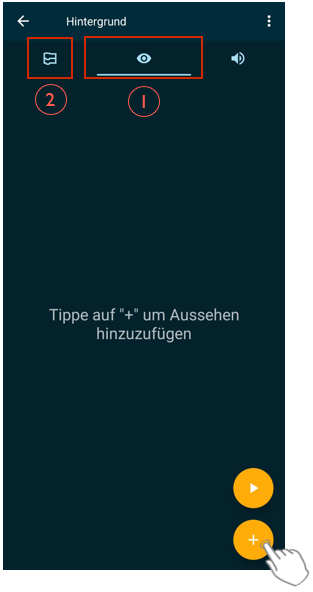

คุณสามารถเพิ่มพื้นหลังให้โปรเจกต์ของคุณใน Catrobat ได้

พื้นหลังใช้ได้หลายวิธี ใน Pocket Code เราใช้พื้นหลังเพื่อทำให้ **เกม** ดูสวยขึ้น เล่า **เรื่องราว** หรือให้ตัวละครและวัตถุของคุณมีบริบทมากขึ้น

สำหรับอุปกรณ์ makerspace อย่าง **พลอตเตอร์** หรือ **เครื่องปักลาย** พื้นหลังทำหน้าที่เป็นแบบร่างการออกแบบ เช่น แบบตัดหรือลวดลายปัก

หากต้องการเพิ่มพื้นหลัง ให้กด "พื้นหลัง" ในหน้าโปรเจกต์

ใน **ส่วนสคริปต์ (2)** คุณเขียนโปรแกรมให้พื้นหลังได้ แต่บล็อกบางอย่างใช้ไม่ได้ บล็อกสองอันต่อไปนี้สำคัญมาก:  และ 

ใน **ส่วนรูปลักษณ์ (1)** คุณจะเพิ่มพื้นหลังได้ ให้กดสัญลักษณ์บวก

คุณสามารถอัปโหลดรูปของคุณเอง ใช้พื้นหลังที่เตรียมไว้ หรือสร้างพื้นหลังด้วยตัวเองก็ได้

**วาดรูป**: คุณสร้างพื้นหลังของตัวเองด้วย **Pocket Paint** ได้ Pocket Paint คือโปรแกรมวาดรูป ([ดูเพิ่มเติมเกี่ยวกับ Pocket Paint](https://catrobat.org/docs/pocket-paint/))

**รูปลักษณ์**: เลือกพื้นหลังจากชุดพื้นหลังที่เตรียมไว้ ([ดูเพิ่มเติมเกี่ยวกับคลังสื่อ](../elements/medialibrary.md))

**แกลเลอรี**: คุณเลือกรูปจากแกลเลอรีของสมาร์ทโฟนได้

**ถ่ายภาพ**: คุณใช้กล้องของอุปกรณ์ถ่ายรูปและเพิ่มเป็นพื้นหลังได้

ตอนนี้คุณเพิ่มพื้นหลังแล้ว กดลูกศรย้อนกลับที่มุมขวาบนเพื่อกลับไป **หน้าโปรเจกต์**
