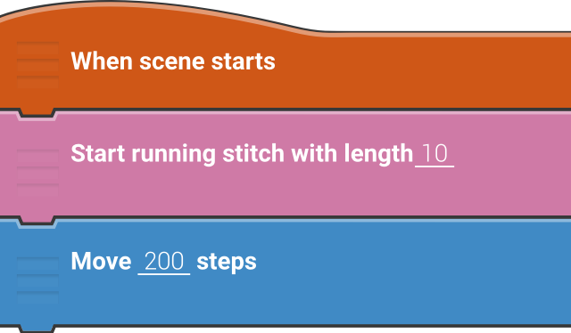

Hayaan ang makina na mag-stitch nang patuloy sa isang variable length.

Karaniwan kang kumbinasyon ng pagmamaneho na stitch sa isang block ng code ng paglipat.

Ang makina ay magsimula ng isang tumatakbo na pag-aayos na magpapahit sa bawat **10 hakbang**.

Pagkatapos ay lumipat ang makina **200 hakbang**.

Nagresulta ito sa **20 mga sugat**.

Ang tumatakbo na pag-uikot ay nagiging mas madali ang pag-uikot ng isang suot dahil hindi ka na nangangailangan ng isang loop.

