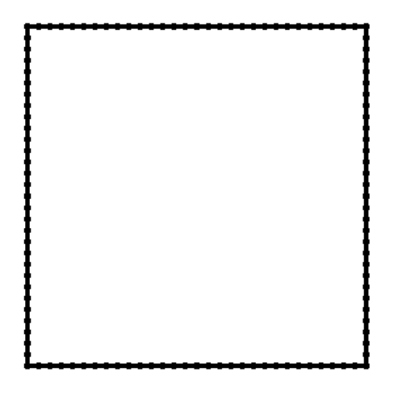

Sa tutorial na ito, matututunan mo kung paano mag-embroider ng isang square (60 x 60mm).

Dapat mong alam na kung paano lumikha ng isang bagong bagay at isulud ang mga bloke ng code doon. Mag-ingat na tingnan ang mga tutorial sa [Mga serye ng simula](../../game-tutorials/starter-tutorials/index.md) kung kailangan mo pa rin ng tulong. Bilang karagdagan, ang mga block ng code sa embroidery ay dapat na naka-activate. Maaari mong malaman kung paano gawin ito sa **[I-activate ang mga block ng code ng Embroidery](activate-embroidery-bricks.md)**-tutorial.

Para sa karagdagang impormasyon o mga suhestiyon para sa disenyo, tingnan ang iba pang mga tutorial.

*Dito maaari mong i-download ang tutorial sa PDF -format*:

[Karga](../../../media/embroidery-tutorials/Square.pdf)

### 1. Gumawa ng isang bagong bagay sa pagsusuot (tingnan ang [Gumawa ng mga bagay na mag-embroidery](create-embroidery-objects.md)).

### 2. Ngayon magsimula at ipasok ang mga block ng code hakbang sa iyong script.

Ang isang square ay binuo mula sa apat na linya, na nakikipagkita sa isa't isa sa isang 90° angkop.

Sa simula, ang script ay nagmamadali ng pag-aayos. Pagkatapos nito, inililipat niya ang isod ng 300 hakbang at sinisilip ito sa 90°. Ito ay paulit-ulitin 4 mga beses.

Ano ang mangyayari kung i-adjust mo ang anggulo o ang mga hagdan? **Subukan mo!**

### 3. I-tap ang play upang simulan ang iyong disenyo!
