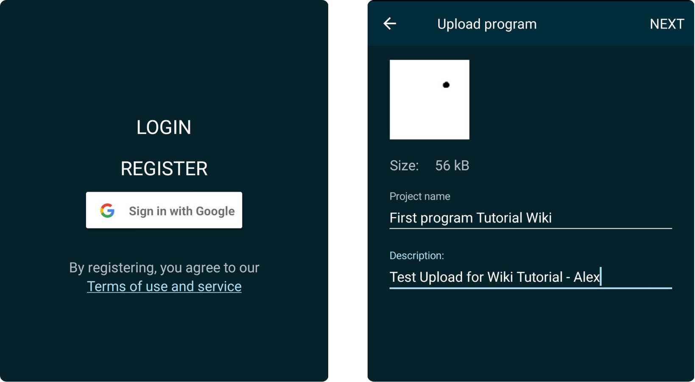

Bu eğitimde yaptığın projeleri arkadaşlarınla veya bütün Catrobat topluluğuyla nasıl paylaşacağını öğreneceksin.

\
Bu eğitimde yaptığın projeleri arkadaşlarınla veya bütün Catrobat topluluğuyla nasıl paylaşacağını öğreneceksin.\
[Resmi aç](../../../media/game-tutorials/Upload-and-Share.png)

Bu eğitim için paylaşmak istediğin kendi projen olmalı. Henüz proje yapmayı bilmiyorsan **[Yeni proje](new-project.md)** eğitimine bak ve nasıl yapıldığını öğren.

*Eğitimi buradan PDF olarak indirebilirsin:*

[PDF’yi aç](../../../media/game-tutorials/Upload-and-Share.pdf)

### 1. Proje seçenekleri

Projeni yüklemek veya paylaşmak istiyorsan projeni aç.

\
Sonra sağ üst köşedeki üç noktaya ve ardından “Proje seçenekleri”ne dokun.\
[Resmi aç](../../../media/game-tutorials/Upload-and-Share.png)

### 2. Proje seçenekleri

Şimdi adı değiştirebilir, bir açıklama ekleyebilir ve farklı ayarlar yapabilirsin.

İki seçeneğin daha var: “Projeyi yükle” ve “Projeyi dışa aktar”.

\
Bunları sonraki adımlarda anlatıyoruz.\
[Resmi aç](../../../media/game-tutorials/Upload-and-Share-1.png)

### 3. Projeyi yükle

Projeni Catrobat Share’e yüklemek ve bütün topluluğun görmesini istiyorsan *Projeyi yükle*yi seç.

### 4. Projeyi yükle

Projeni Share’e yüklemek için bu düğmeye dokunduğunda, henüz hesabın yoksa bir hesap açman gerekir. İstersen Google ile de giriş yapabilirsin. Giriş yaptıktan sonra projene bir ad ver ve bir açıklama yaz. Sonra programına en çok uyan en fazla üç kategori seç.

\
Sonra programını yüklemek için “İleri”ye dokun.\
[Resmi aç](../../../media/game-tutorials/Upload-and-Share-2.png)

### 5. Projeyi dışa aktar

Projeni arkadaşlarınla paylaşmak istiyorsan *Projeyi dışa aktar*ı seç.

### 6. Projeyi dışa aktar

Bu düğmeyle bir .catrobat dosyası kaydedersin. Bu dosyayı arkadaşlarınla özel olarak paylaşabilirsin.

\
Dosyayı cihazındaki dosya yöneticisine kaydedip oradan paylaşabilirsin.\
[Resmi aç](../../../media/game-tutorials/Upload-and-Share-3.png)

Başardın! İlk programını paylaştın!

Yeni projeler için yardıma veya fikre ihtiyacın olursa farklı seviyelerdeki (Başlangıç/Orta/İleri) eğitimlerimize bakabilirsin.
