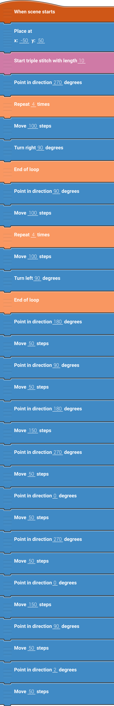

У цьому уроці ти навчишся вишивати кріпера з Minecraft (80 x 80 мм).

Ти вже маєш знати, що таке цикл і як він працює.

Урок **[Квадрат](../embroidery-tutorials-beginner/square.md)** може стати в пригоді для цього уроку.

Подивися уроки з вишивання в серії [для початківців](../embroidery-tutorials-beginner/index.md), якщо ти ще нічого не вишивав.

Щоб дізнатися більше або отримати ідеї для дизайнів, подивися інші уроки.

*Ось ти можеш завантажити цей урок у форматі PDF*:

[Кріпер Minecraft (англійською)](../../../media/embroidery-tutorials/Creeper-Minecraft-en.pdf)

### 1. Створи новий вишивальний об’єкт (див. [Створити об’єкти для вишивки](../embroidery-tutorials-beginner/create-embroidery-objects.md)) і встав такі скрипти:

### 2. Обличчя

### 3. Контур

### 4. Натисни «Запустити», щоб почати свій дизайн!
