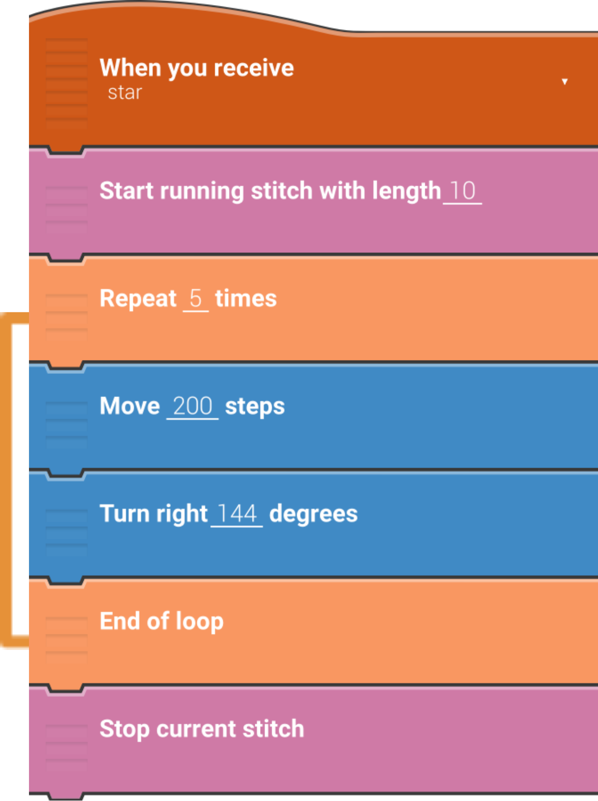

У цьому уроці ти навчишся вишивати нічне небо (48.5 x 96.1 мм).

Ти вже маєш знати, що таке цикл і як він працює.

Урок **[Зірка](../embroidery-tutorials-beginner/star.md)** може стати в пригоді для цього уроку.

Також це корисно, якщо ти вже знайомий із блоком «Оповістити».

Подивися уроки з вишивання в серії [для початківців](../embroidery-tutorials-beginner/index.md), якщо ти ще нічого не вишивав.

Щоб дізнатися більше або отримати ідеї для дизайнів, подивися інші уроки.

*Ось ти можеш завантажити цей урок у форматі PDF*:

[Нічне небо](../../../media/embroidery-tutorials/Night-Sky.pdf)

### 1. Створи новий вишивальний об’єкт (див. [Створити об’єкти для вишивки](../embroidery-tutorials-beginner/create-embroidery-objects.md)) і встав такі скрипти:

### 2. Місяць

### 3. Одна зірка

Ця частина викликається щоразу, коли надсилається повідомлення «зірка». Додай її також до свого скрипта.

### 4. Усі зірки

### 5. Натисни «Запустити», щоб почати свій дизайн!
