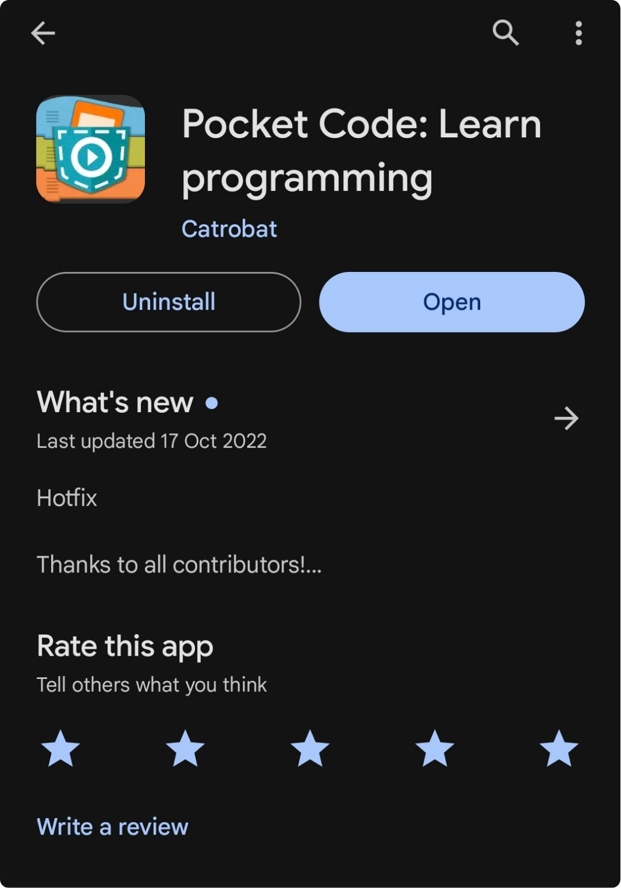

У цьому уроці ти дізнаєшся все, що треба знати про Pocket Code, щоб почати створювати свій перший проєкт. Ми покроково покажемо, як завантажити застосунок, відкрити його й створити новий проєкт.

Це найперший урок, і знань для нього не потрібно.

Тож на що чекаєш? Візьми телефон і починай просто зараз!

*Ось ти можеш завантажити цей урок у форматі PDF:*

[Нова програма](../../../media/game-tutorials/New-Program.pdf)

### 1. Встановлення Pocket Code

Спочатку треба встановити застосунок Pocket Code на свій пристрій. Знайти його можна, ввівши «Pocket Code» у Google Play Store, і натиснути «Установити». Для цього кроку потрібен обліковий запис Google. Тепер пристрій завантажить і встановить застосунок. Цей крок може тривати деякий час залежно від швидкості інтернету.

Після успішного завантаження й встановлення Pocket Code ти знайдеш застосунок у списку застосунків або на головному екрані — залежно від пристрою. Застосунок можна легко перемістити в будь-яке зручне місце.

### 2. Запусти застосунок

Коли відкриваєш застосунок, бачиш різні категорії:

### 3. Створи новий проєкт

Наступний крок — створити новий проєкт. Для цього натисни жовту кнопку «плюс» у правому нижньому куті. Тепер треба ввести назву проєкту і вибрати, чи має проєкт бути горизонтальним. Натиснувши «ОК», створиш проєкт.

### 4. Готово! Ти створив свій новий проєкт.

Тепер ти встановив Pocket Code і знаєш, як створити новий проєкт. Тепер можна починати програмувати!

Щоб це робити, треба знати, як створити новий об’єкт у проєкті. Подивися урок **[Новий об’єкт](new-object.md)**, де все пояснено крок за кроком.
