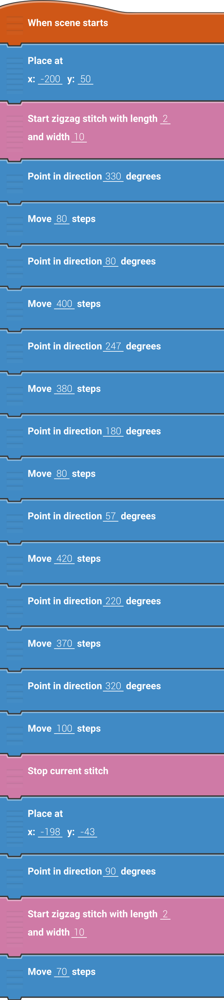

اس سبق میں، تم سیکھیں گے کہ ایک کاغذی پلیٹ (58.2 x 80.7 ملی میٹر) کو کس طرح بنے.

اگر تم نے ابھی تک کچھ بھی نہیں کڑھائی کی ہے تو [ابتدائی](../embroidery-tutorials-beginner/index.md) سیریز میں کڑھائی کے سبق کو دیکھو.

مزید معلومات یا ڈیزائن کے تجاویز کے لیے دیگر سبق ملاحظہ کرو۔.

*یہاں تمہیں ٹیوٹوریل میں ڈاؤن لوڈ کر سکتے ہو PDF فارمیٹ*:

[کاغذی طیارہ](../../../media/embroidery-tutorials/Paper-Plane.pdf)

### 1. ایک نئی کڑھائی کی چیز بنائیں (دیکھو [کڑھائی کے اشیاء بنائیں](../embroidery-tutorials-beginner/create-embroidery-objects.md)) اور مندرجہ ذیل اسکرپٹ داخل کرو:

### 2. اپنے ڈیزائن شروع کرنے کے لئے کھیل پر ٹیپ کرو!
