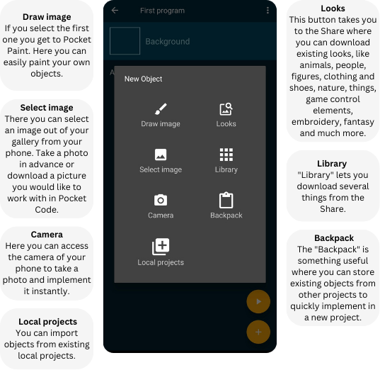

اس سبق میں، تم سیکھیں گے کہ اپنے منصوبے میں ایک نیا اعتراض کیسے بنایا جائے اور اس کے لئے تمہارے پاس مختلف امکانات ہیں.

ایسا کرنے کے لئے، تمہیں پہلے ہی Pocket Code ایپ ڈاؤن لوڈ کرنا چاہئے اور ایک نیا منصوبہ کیسے بنانا ہے. اگر تمہیں اس کے ساتھ مدد کی ضرورت ہو تو، **[نیا پروجیکٹ](new-project.md)** - ٹیوٹوریل پر ایک نظر ڈالنے کے لئے آزاد محسوس کرو.

*یہاں تم ٹیوٹوریل کو PDF فارمیٹ میں ڈاؤن لوڈ کرسکتے ہیں:*

[نیا اعتراض](../../../media/game-tutorials/New-Object.pdf)

### 1. ایک نیا اعتراض بنائیں

پہلے تمہیں اپنا نیا پروجیکٹ کھولنے کی ضرورت ہے۔.

تم اسے Pocket Code ایپ کی ہوم اسکرین پر تلاش کرو گے۔. اگر تمہارے پاس ایک سے زیادہ منصوبے ہیں تو، تم ”پروجیکٹس“ پر کلک کر سکتے ہو۔. پھر اپنا نیا پروجیکٹ منتخب کرو۔. اگر تم نے کوئی نیا پروجیکٹ نہیں بنایا ہے یا اس کے بارے میں مزید معلومات کی ضرورت ہے تو، **[نیا پروجیکٹ](new-project.md)** - ٹیوٹوریل پر ایک نظر ڈالیں.

### 2. ایک نیا اعتراض بنائیں

اب تم ایک نیا اعتراض پیدا کرنے کے لئے تیار ہیں. ایسا کرنے کے لئے صرف نیچے دائیں کونے پر زرد پلس بٹن پر کلک کرو. تمہیں ایک نئی ونڈو نظر آئے گی جس میں سے تمہارے انتخاب کے لئے سات امکانات ہیں.

### 3. تخلیق کرنے کے طریقے

تم مندرجہ ذیل اختیارات میں سے انتخاب کر سکتے ہو:

### 4. تصویر ڈرائنگ

شروع کرنے کے لئے یہ سب سے آسان بنانے کے لئے، ہم ”تصویر بنائیں“ تقریب کا استعمال کرتے ہوئے اور صرف ایک نقطہ ڈرا کرنا چاہتے ہو. جب تم نے Pocket Paint کے ساتھ نقطہ کو ڈرا دیا ہے تو تم اسے چھوڑ سکتے ہیں (ایک قدم پیچھے جا کر).

### 5. ایک نام دیں

اب تمہیں اپنی تصویر کا نام دینا ہوگا.

### 6. اسے رکھ

اس کے بعد تمہیں اسے بائیں / دائیں یا اپنی انگلی سے اوپر / نیچے منتقل کرکے بصری طور پر رکھنا ہوگا. تمہیں اسے اوپر دائیں کونے میں بٹن کے ساتھ محفوظ کرنا ہوگا.

::brick{type=PlaceAtBrick}

### 7. تم نے اسے بنایا! تم نے اپنا نیا اعتراض پیدا کیا.

اب تمہارے پاس ایک پروجیکٹ ہے جس میں تم کسی چیز کو پروگرام کرسکتے ہیں!

اس کے لیے تمہیں یہ جاننا چاہیے کہ کون سے کوڈ بلاک دستیاب ہیں۔. **[پہلا کوڈ بلاک](first-bricks.md)** - سبق تمہیں مختلف قسم کے کوڈ بلاکس کا ایک اچھا جائزہ دیتا ہے. تاہم، تم اپنے پہلے منصوبے سے بھی براہ راست شروع کر سکتے ہو. ابتدائی سیریز سے مناسب ٹیوٹوریل منتخب کرو۔.
