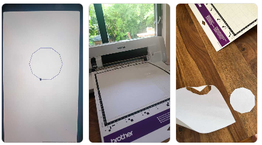

تم اپنی پلاٹ پیدا کرنا چاہتے ہو؟ ہمارے سبق تمہیں کٹائی کرنے والے سازش پر ڈرائنگ لائنوں کو کاٹنے کے لئے کوڈ بلاک استعمال کرنے کی طرف رہنمائی کرتے ہو. اپنی ڈیزائن کو درست اور تخلیقی انداز میں زندگی میں لانے کے لئے ضروری تکنیکوں اور اوزار سیکھیں۔.
