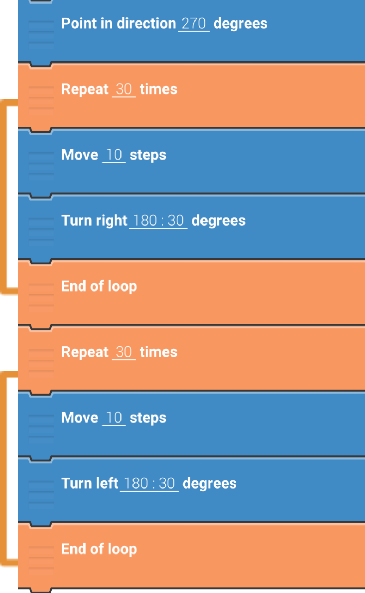

Ushbu darsda sen Yin va Yang (78,4 x 78,4 mm) ni qanday tikishni o'rganasiz.

Sen allaqachon bu chiziq nima va u qanday ishlaydi bilasiz.

**[Duruv](../embroidery-tutorials-beginner/circle.md)** -bu o'quv uchun foydali bo'lishi mumkin.

Agar hali hech narsa tikmagan bo'lsangiz, [Boshlang ' ichlar](../embroidery-tutorials-beginner/index.md) seriyasidagi tikish o'quv qo'llanmalariga qarang.

Ko'proq ma'lumot yoki dizayn takliflari uchun boshqa o'quv qo'llanmalariga qarang.

*Bu yerda sen PDF formatida o'quvni yuklab olishingiz mumkin*:

[Yin va Yang](../../../media/embroidery-tutorials/Yin-and-Yang.pdf)

### 1. Yangi tikish obyekti yaratish (qarang [Qitish ob'ektlarini yaratish](../embroidery-tutorials-beginner/create-embroidery-objects.md)):

### 2. Katta toʻronda quyidagi skriptni qoʻshing:

### 3. Oʻrta egri chiziq

Serialingizga ham ushbu qismni qoʻshing:

### 4. Kichik to'plamning yuqori qismida

Yangi tikish ob'ekti yarating va quyidagi skriptni qo'shing:

### 5. Kichik aylanani nusxalating

Sen faqat 4-qadamdan obʼektni nusxa olishingiz mumkin:

### 6. Kichik aylaning pastki qismi

Ikkinchi to'plamning joyini o'zgartirishingiz kerak:

### 7. Dizaynni boshlash uchun o'ynashga bos!
