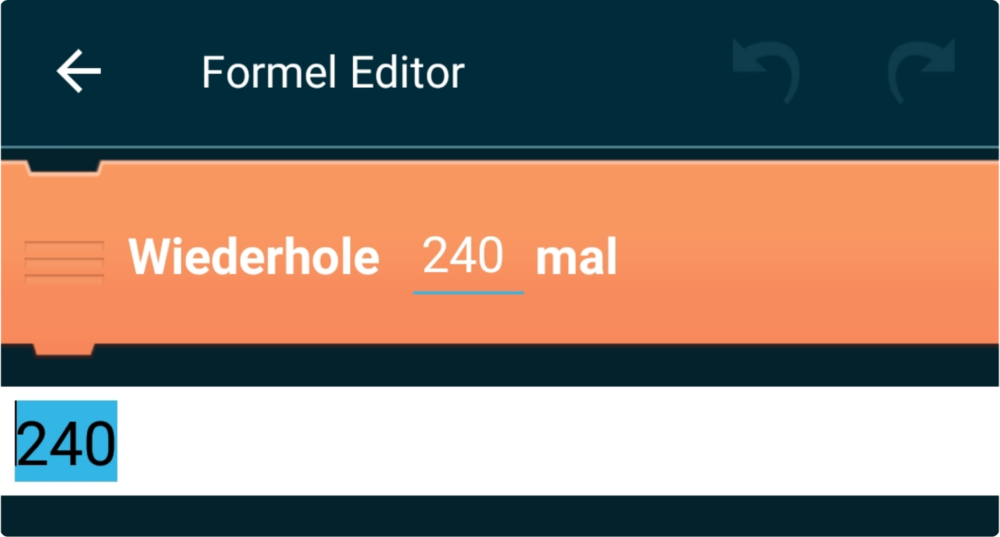

Trong hướng dẫn này, bạn sẽ học cách thêu một hình tròn (76,2 x 76,2 mm).

Bạn cần đã biết cách tạo đối tượng mới và thêm khối lệnh vào đó. Nếu vẫn cần trợ giúp, hãy xem các hướng dẫn trong loạt [Cơ bản](../../game-tutorials/starter-tutorials/index.md). Ngoài ra, các khối lệnh thêu phải được bật sẵn. Bạn có thể xem cách làm trong hướng dẫn **[Bật khối lệnh thêu](activate-embroidery-bricks.md)**.

Để biết thêm thông tin hoặc gợi ý thiết kế, hãy xem các hướng dẫn khác.

*Bạn có thể tải hướng dẫn này ở định dạng PDF tại đây*:

[Hình tròn](../../../media/embroidery-tutorials/Circle.pdf)

### 1. Tạo một Đối tượng thêu mới (xem [Tạo đối tượng thêu](create-embroidery-objects.md)).

### 2. Bây giờ hãy bắt đầu và thêm từng khối lệnh vào kịch bản của bạn.

### 3. Nhấn chạy để bắt đầu thiết kế của bạn!

Bạn phải xác định góc xoay, ở đây là 360 ÷ 60.

360 luôn luôn giữ nguyên đối với hình tròn! Vì vậy bạn cần đặt số lần lặp cho phù hợp, ví dụ 60 ở đây. **Hãy thử các cách kết hợp khác!** Ví dụ: 30 và 360 ÷ 30, hoặc 120 và 360 ÷ 120.
