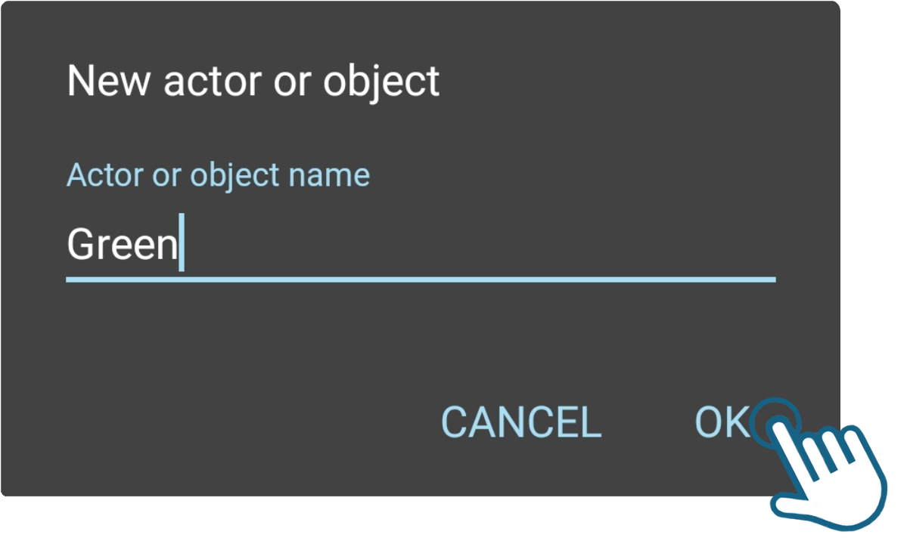

Trong hướng dẫn này, bạn sẽ học cách tạo các đối tượng để sau này thêu các mẫu của bạn.

Với hướng dẫn này, bạn cần đã biết cách tạo dự án. Nếu cần trợ giúp, hãy xem các hướng dẫn trong loạt [Cơ bản](../../game-tutorials/starter-tutorials/index.md).

Để biết thêm thông tin hoặc gợi ý thiết kế, hãy xem các hướng dẫn khác.

*Bạn có thể tải hướng dẫn này ở định dạng PDF tại đây*:

[Tạo đối tượng thêu](../../../media/embroidery-tutorials/Create-Embroidery-Objects.pdf)

### 1. Nhấn nút dấu cộng ở góc dưới bên phải dự án để thêm đối tượng mới.

### 2. Để chọn một hình, hãy vào thư viện phương tiện.

### 3. Một Đối tượng thêu tương ứng với một lớp của kim máy thêu. Nhiều Đối tượng thêu sẽ được thêu lần lượt nối tiếp nhau. Nhờ vậy bạn có thể dùng nhiều màu.

Bạn có thể chọn đối tượng tùy theo màu bạn muốn.

Cuộn xuống và tìm mũi tên phù hợp.

### 4. Đặt tên phù hợp cho đối tượng mới và nhấn OK.

### 5. Bạn đã tạo xong một đối tượng mới. Bây giờ bạn có thể thêm kịch bản và lập trình cho đối tượng.

Bây giờ bạn đã biết cách tạo đối tượng. Hãy thêm một đối tượng mới cho mỗi màu bạn muốn dùng.

Bạn có thể thêm kịch bản cho mỗi màu và lập trình những thiết kế riêng của mình, rồi thêu chúng sau này.

Bạn cần cảm hứng hoặc trợ giúp? Hãy xem các hướng dẫn khác của chúng tôi!
