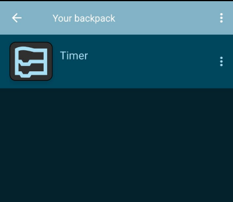

Tính năng **ba lô** trong Pocket Code là một chức năng tiện lợi, cho phép bạn **lưu và dùng lại** các thành phần như nhân vật (đối tượng), kịch bản, diện mạo hoặc âm thanh **giữa các dự án**. Nhờ đó, bạn tiết kiệm thời gian và làm dự án gọn gàng hơn.

Ba lô giống như một kho lưu trữ số, nơi bạn cất các thành phần từ dự án hiện tại. Khi đã cất vào ba lô, bạn có thể lấy ra và thêm các thành phần đó vào dự án khác.

### Làm sao để dùng ba lô cho nhân vật (đối tượng)?

**Cất nhân vật vào ba lô**

Mở chế độ xem dự án của dự án có nhân vật bạn muốn cất vào ba lô.

Nhấn vào ba chấm bên cạnh nhân vật để mở menu ngữ cảnh, rồi chọn “Cất vào ba lô.”

Nhân vật (kèm theo diện mạo, âm thanh và kịch bản) sẽ được cất vào ba lô.

**Thêm nhân vật từ ba lô**

Mở dự án nơi bạn muốn thêm nhân vật.

Trong chế độ xem dự án, chạm vào dấu cộng và chọn “Ba lô.”

Bây giờ bạn sẽ thấy mọi nhân vật và đối tượng đã lưu trong ba lô. Chạm vào ba chấm rồi chọn “Lấy ra.”

***

### Làm sao để dùng ba lô cho kịch bản?

**Cất kịch bản vào ba lô:**

Đi đến nhân vật có chứa kịch bản. Giữ ngón tay trên kịch bản mong muốn trong trình soạn kịch bản.

Chọn “Thêm vào ba lô” trong menu ngữ cảnh.

Đặt tên cho kịch bản rồi xác nhận bằng OK.

Kịch bản đã được lưu và có thể dùng trong các dự án khác.

**Thêm kịch bản từ ba lô:**

Chạm vào nhân vật nơi bạn muốn thêm kịch bản. Bạn sẽ thấy khu vực kịch bản. Chạm vào ba chấm để mở menu ngữ cảnh, rồi chạm vào “Ba lô”.

Bây giờ bạn sẽ thấy mọi kịch bản đã có trong ba lô. Chạm vào ba chấm bên cạnh kịch bản mong muốn rồi chọn “Lấy ra” trong menu ngữ cảnh.

Cũng trong menu ngữ cảnh, bạn có thể xóa những kịch bản không còn cần trong ba lô.

***

### Lợi ích của ba lô

- **Dùng lại giữa các dự án:** Nhân vật, kịch bản, âm thanh và diện mạo chỉ cần tạo một lần và có thể dùng lại bao nhiêu lần tùy ý.
- **Tiết kiệm thời gian:** Bạn không phải tạo lại nhân vật hay kịch bản mỗi lần.
- **Nhất quán:** Các thành phần giữ nguyên khi bạn cần dùng ở nhiều dự án.
