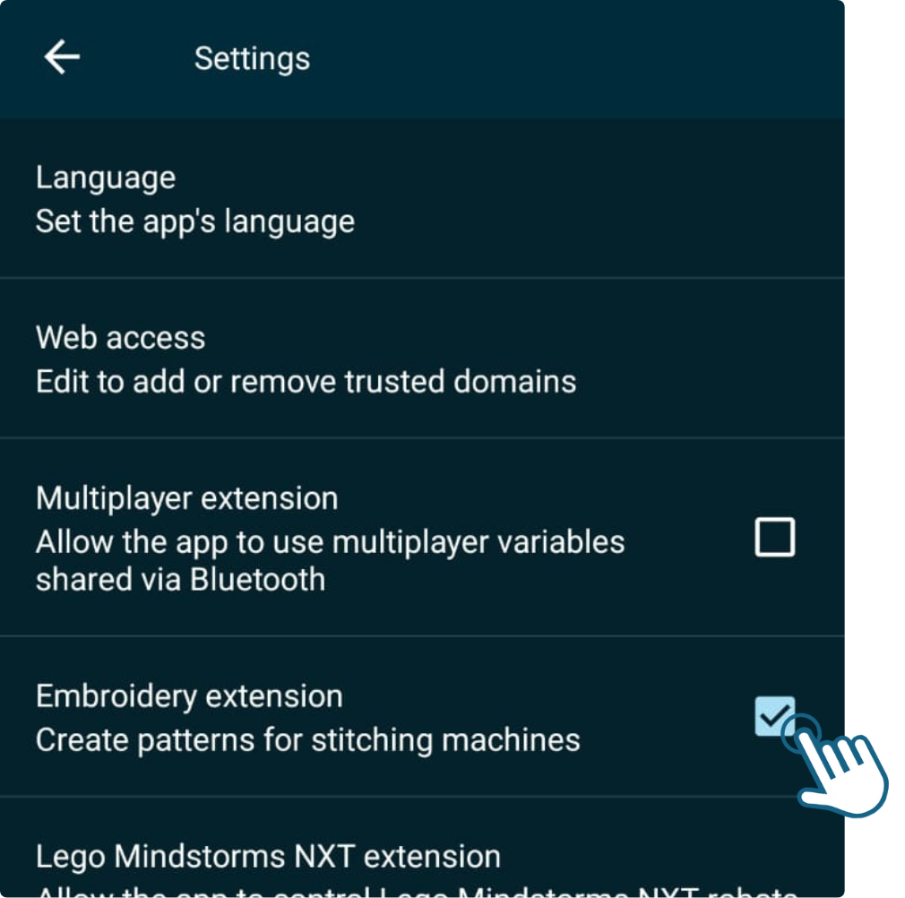

在本教程中，将讲解如何启用刺绣积木。

这个步骤不需要任何编程知识。这是开始刺绣教程的第一步。之后，你就能设计、编程，甚至把你自己的设计绣在你喜欢的布料上。

如需更多信息或设计灵感，请看看其他教程。

*你可以在这里下载 PDF 格式的教程*：

[启用刺绣积木](../../../media/embroidery-tutorials/ActivateEmbroideryBricks.pdf)

### 1. 启动“Pocket Code”应用，按照下面的步骤操作！

### 2. 打开菜单（右上角的三个点）。

### 3. 进入“设置”。

### 4. 选择“刺绣扩展”。

### 5. 你会在积木中找到一个单独的刺绣类别！

现在，你也可以在其他积木中找到所有刺绣积木。

如需了解每个积木的更多信息，可以在[这里](../../../reference/)查看积木说明，或者学习**[刺绣积木](embroidery-bricks/index.md)**教程。

现在你可以开始设计自己的图案了！

如果你需要灵感或帮助，请看看其他教程，或者继续学习**[创建刺绣对象](create-embroidery-objects.md)**教程。
