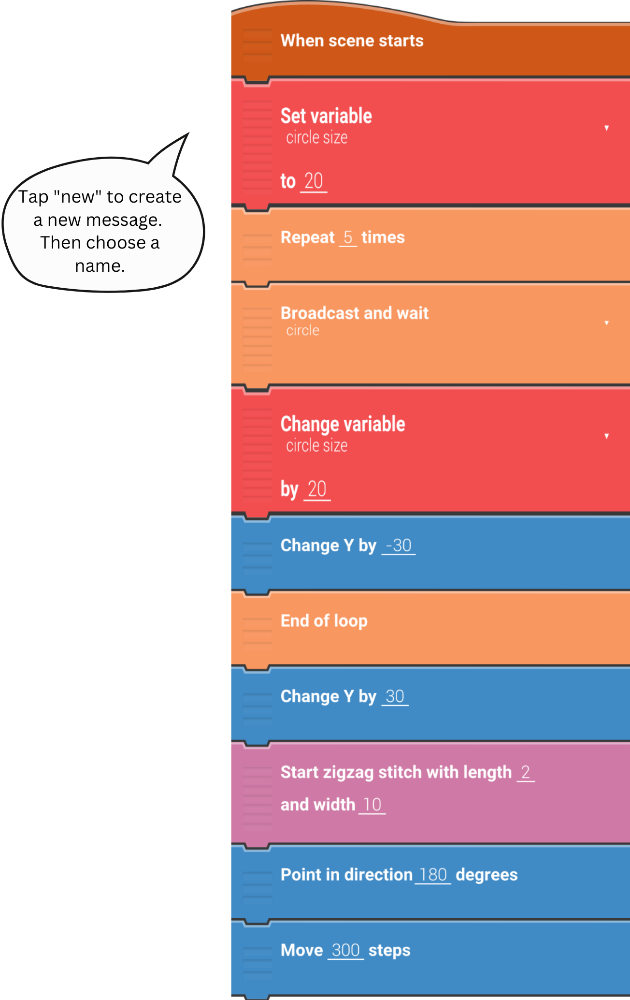

在這個教學中，你會學到如何繡出一支棒棒糖（124.6 x 65.6 公釐）。

你應該先知道什麼是迴圈，以及迴圈如何運作。

**[圓形](../embroidery-tutorials-beginner/circle.md)**教學可能會對這個教學有幫助。

如果你還沒繡過任何東西，請看看[初級](../embroidery-tutorials-beginner/index.md)系列的刺繡教學。

如需更多資訊或設計建議，請看看其他教學。

*你可以在這裡下載 PDF 格式的教學*：

[棒棒糖（高級）](../../../media/embroidery-tutorials/LollipopPro.pdf)

### 1. 建立新的刺繡物件（請參考[建立刺繡物件](../embroidery-tutorials-beginner/create-embroidery-objects.md)），並加入以下腳本：

### 2. 基本結構

### 3. 圓形

每次送出圓形訊息時，就會執行這個部分。也要把它加到你的腳本中。

### 4. 點選開始，開始繡出你的設計！
